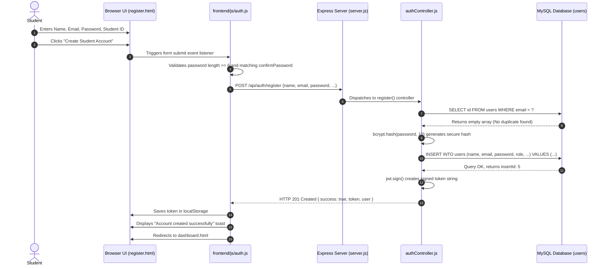
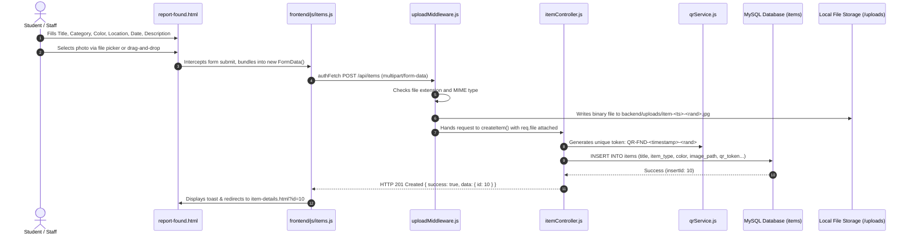
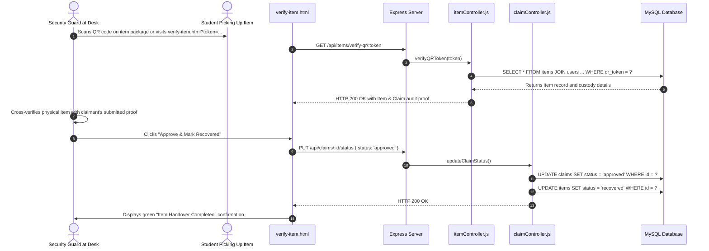
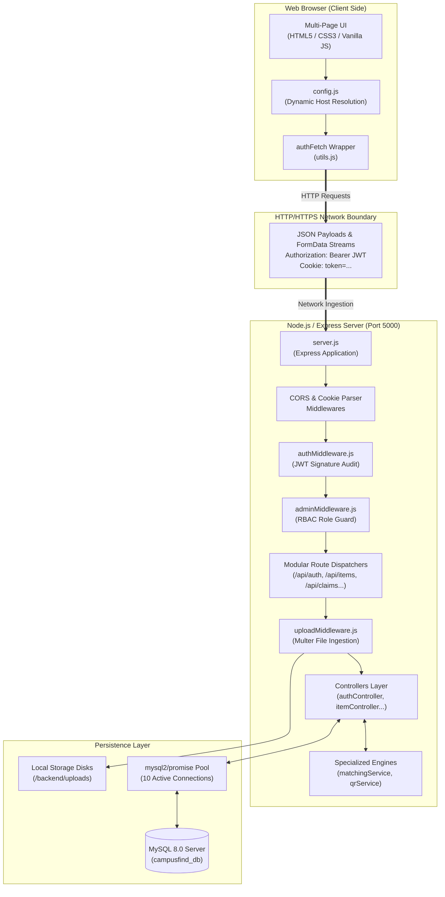
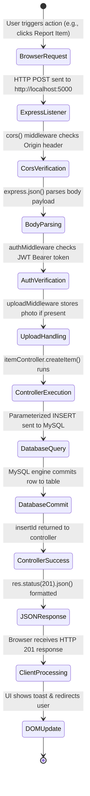
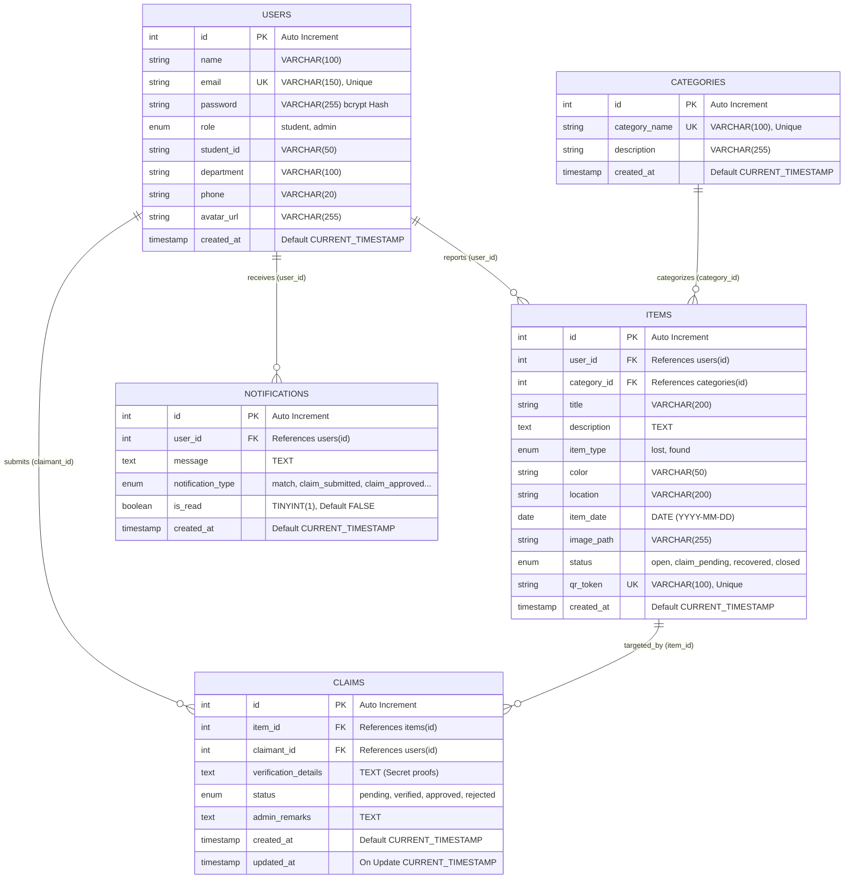

# COMPLETE PROJECT EXPLANATION & VIVA PREPARATION MASTER GUIDE
**Project Name:** CampusFind 2.0 — Smart Campus Lost & Found Management Platform  
**Academic Subject:** Web Technology / Advanced Web Engineering (Project-Based Learning — PBL)  
**Target Audience:** Beginner to Intermediate Web Developers preparing for University Practical Examinations and Viva Voce Defense.

---

## TABLE OF CONTENTS
1. [Phase 1: Complete Project Directory Analysis](#phase-1-complete-project-directory-analysis)
2. [Phase 2: Complete Technology Stack Explanation](#phase-2-complete-technology-stack-explanation)
3. [Phase 3: Folder-by-Folder and File-by-File Code Breakdown](#phase-3-folder-by-folder-and-file-by-file-code-breakdown)
   - [3.1 Backend Entry & Core Configuration](#31-backend-entry--core-configuration)
   - [3.2 Backend Middlewares (Security, Uploads & Error Handling)](#32-backend-middlewares)
   - [3.3 Backend Controllers (Core Business Logic)](#33-backend-controllers)
   - [3.4 Backend Routes (API Endpoints)](#34-backend-routes)
   - [3.5 Backend Services (Specialized Engines)](#35-backend-services)
   - [3.6 Database Architecture (DDL & DML)](#36-database-architecture)
   - [3.7 Frontend Architecture (HTML, CSS, JS)](#37-frontend-architecture)
4. [Phase 4: Understanding Frontend, Backend & Database Connectivity (From Scratch)](#phase-4-understanding-connectivity)
   - [4.1 What is Frontend?](#41-what-is-frontend)
   - [4.2 What is Backend?](#42-what-is-backend)
   - [4.3 What is a Database?](#43-what-is-a-database)
   - [4.4 Detailed Frontend-to-Backend Connectivity Guide](#44-detailed-frontend-to-backend-connectivity)
   - [4.5 Detailed Backend-to-Database Connectivity Guide](#45-detailed-backend-to-database-connectivity)
5. [Phase 5: Complete End-to-End Data Flows](#phase-5-complete-end-to-end-data-flows)
   - [5.1 Student Registration Flow](#51-student-registration-flow)
   - [5.2 Student Login & Session Hydration Flow](#52-student-login-flow)
   - [5.3 Reporting a Belonging with Multer File Upload](#53-reporting-flow)
   - [5.4 Heuristic Match Detection & Alert Flow](#54-matching-flow)
   - [5.5 Ownership Claim Submission & Admin Audit Flow](#55-claim-flow)
   - [5.6 Physical Custody Handover via QR Code Verification Flow](#56-qr-verification-flow)
6. [Phase 6: System Architecture & Visual Diagrams (Mermaid)](#phase-6-system-architecture--diagrams)
7. [Phase 7: Comprehensive REST API Reference Documentation](#phase-7-api-documentation)
8. [Phase 8: Complete Database Technical Explanation & ER Diagram](#phase-8-database-explanation)
9. [Phase 9: Fundamental Backend Concepts Explained with Real-World Analogies](#phase-9-backend-concepts)
10. [Phase 10: Master Viva Voce Question Bank (120+ In-Depth Questions & Answers)](#phase-10-viva-question-bank)
    - [Category A: Project Overview & Motivation](#category-a-project-overview)
    - [Category B: Frontend Engineering](#category-b-frontend)
    - [Category C: Backend & Node.js/Express.js Engineering](#category-c-backend)
    - [Category D: Relational Database & MySQL Architecture](#category-d-database)
    - [Category E: Frontend-to-Backend Communication & Networking](#category-e-networking)
    - [Category F: Backend-to-Database Connectivity](#category-f-db-connectivity)
    - [Category G: Web Security & Cryptography](#category-g-security)
    - [Category H: Project-Specific Architecture & Algorithms](#category-h-project-specific)
    - [Category I: Tricky Examiner Edge-Case Questions](#category-i-tricky-examiner-questions)
    - [Category J: Live Practical Demonstration Scenarios](#category-j-practical-demonstration)
11. [Phase 11: Step-by-Step Project Demonstration Script for Examiners](#phase-11-project-demonstration-script)
12. [Phase 12: Final Rapid Revision Notes](#phase-12-final-rapid-revision-notes)
    - [12.1 Project in 2 Minutes](#121-project-in-2-minutes)
    - [12.2 Architecture in 1 Minute](#122-architecture-in-1-minute)
    - [12.3 Top 30 Most Frequent Questions](#123-top-30-questions)
    - [12.4 15 Essential Files to Remember](#124-15-essential-files)
    - [12.5 Core Code Snippets Cheatsheet](#125-core-code-snippets)
    - [12.6 Beginner's Technical Glossary](#126-beginners-glossary)

---

# PHASE 1: COMPLETE PROJECT DIRECTORY ANALYSIS

### 1.1 Project Root Directory
- **Root Path:** `CampusFind_PBL/`
- **Application Type:** Multi-Page Web Application (MPA) with a decoupled RESTful JSON API Backend and a Relational MySQL Database.

### 1.2 Complete Directory Tree

```text
CampusFind_PBL/
│
├── .gitignore                           # Git ignore rules for node_modules, .env, and uploads
├── README.md                            # High-level academic project README with phase tracker
├── CampusFind_PBL_Report.docx           # Official academic project report document
├── CampusFind_PBL_Presentation.pptx     # Official academic PowerPoint presentation slide deck
├── COMPLETE_PROJECT_EXPLANATION_AND_VIVA.md # Comprehensive self-contained technical master guide
│
├── backend/                             # Node.js & Express.js REST API Server
│   ├── .env                             # Server environment variables (DB credentials, JWT secret, ports)
│   ├── .env.example                     # Environment template for developers
│   ├── package.json                     # Backend npm dependencies and scripts
│   ├── package-lock.json                # Locked dependency tree
│   ├── server.js                        # Main application entry point & Express bootstrap
│   │
│   ├── config/
│   │   └── db.js                        # MySQL2 connection pool setup and health check
│   │
│   ├── middleware/
│   │   ├── authMiddleware.js            # JWT verification and user session hydration
│   │   ├── adminMiddleware.js           # Role-based access control (RBAC) guard for admin APIs
│   │   ├── uploadMiddleware.js          # Multer configuration for file uploads (5MB, MIME filter)
│   │   └── errorHandler.js              # Global uncaught error interceptor & JSON formatter
│   │
│   ├── controllers/
│   │   ├── authController.js            # Register, login, logout, profile update, avatar upload
│   │   ├── itemController.js            # Item CRUD, multi-filter search, QR token verification
│   │   ├── matchingController.js        # Rule-based item similarity matching endpoints
│   │   ├── claimController.js           # Claim submission, status transition, anti-fraud guards
│   │   ├── categoryController.js        # Item category listing and creation
│   │   ├── dashboardController.js       # Student KPIs, Admin metrics, Chart.js analytics aggregations
│   │   └── notificationController.js    # In-app notifications feed, mark read, delete
│   │
│   ├── routes/
│   │   ├── authRoutes.js                # Endpoints for authentication (/api/auth)
│   │   ├── itemRoutes.js                # Endpoints for items (/api/items)
│   │   ├── claimRoutes.js               # Endpoints for claims (/api/claims)
│   │   ├── categoryRoutes.js            # Endpoints for categories (/api/categories)
│   │   ├── dashboardRoutes.js           # Endpoints for dashboards (/api/dashboard)
│   │   ├── matchingRoutes.js            # Endpoints for matching (/api/matches)
│   │   ├── notificationRoutes.js        # Endpoints for notifications (/api/notifications)
│   │   └── userRoutes.js                # Endpoints for admin user management (/api/users)
│   │
│   ├── services/
│   │   ├── matchingService.js           # Heuristic 5-factor matching algorithm engine
│   │   ├── qrService.js                 # 2D QR matrix barcode generator (qrcode library)
│   │   └── notificationService.js       # Internal database notification dispatcher
│   │
│   ├── scripts/
│   │   ├── setupDatabase.js             # Automated schema and seed runner script
│   │   ├── updateItemImages.js          # Utility migration script updating item image paths
│   │   ├── testPhase4.js - testPhase8.js# Modular integration unit test suites
│   │   └── testPhase9_Master.js         # Comprehensive master test suite
│   │
│   └── uploads/                         # Permanent physical disk storage for uploaded images
│       ├── .gitkeep                     # Keeps folder in git while ignoring uploaded binaries
│       ├── sample-*.jpg                 # Default catalog product images (bottles, chargers, etc.)
│       └── item-*.jpg                   # User-uploaded belonging and avatar photos
│
├── database/                            # Relational Database SQL Scripts
│   ├── README.md                        # Database schema notes and ERD diagrams
│   ├── schema.sql                       # Complete DDL script (table creation, indexes, foreign keys)
│   └── seed.sql                         # Complete DML script (dummy users, categories, 12 items, claims)
│
├── frontend/                            # Client-Side Web Application (HTML5, CSS3, Vanilla JS)
│   ├── index.html                       # Public Home/Landing Portal
│   │
│   ├── pages/                           # Sub-pages
│   │   ├── login.html                   # Student / Admin authentication portal
│   │   ├── register.html                # Student account creation form
│   │   ├── lost-items.html              # Lost items catalog with search and filters
│   │   ├── found-items.html             # Found items catalog with custody tags
│   │   ├── report-lost.html             # Form to report a misplaced item
│   │   ├── report-found.html            # Form to report a discovered item with image dropzone
│   │   ├── item-details.html            # Single item detailed view with claim modal & QR display
│   │   ├── dashboard.html               # Student dashboard (KPIs, matches feed, personal reports)
│   │   ├── admin-dashboard.html         # Admin console (campus stats, claims audit table, Chart.js)
│   │   ├── my-claims.html               # Student claims tracking view
│   │   ├── notifications.html           # Activity center for student alerts
│   │   ├── profile.html                 # Profile info edit, avatar upload, password change
│   │   └── verify-item.html             # Physical security desk QR token verification terminal
│   │
│   ├── css/                             # Modular Stylesheets
│   │   ├── variables.css                # Color tokens, typography, shadows, border radii
│   │   ├── global.css                   # Base reset, buttons, cards, badges, modals, toasts
│   │   ├── navbar.css                   # Header navigation, hamburger toggle, user dropdown
│   │   ├── footer.css                   # Footer styling and links
│   │   ├── forms.css                    # Form controls, validation states, drag-and-drop dropzones
│   │   ├── items.css                    # Item cards, badges, search bar, item details layout
│   │   ├── dashboard.css                # Sidebar layout, stats cards, admin tables, chart containers
│   │   ├── auth.css                     # Auth card styling and password toggle eye button
│   │   └── responsive.css               # Mobile and tablet media queries
│   │
│   ├── js/                              # Client-side JavaScript Modules
│   │   ├── config.js                    # Dynamic host API URL resolution and system constants
│   │   ├── utils.js                     # authFetch wrapper, session helpers, date helpers, toast alerts
│   │   ├── auth.js                      # Login/register submissions, validation, session storage
│   │   ├── navbar.js                    # Mobile nav toggle, active links, user avatar dropdown, logout
│   │   ├── items.js                     # Item catalog loading, filters, image fallbacks, report forms
│   │   ├── dashboard.js                 # Student dashboard loader, match cards, recent reports
│   │   ├── admin.js                     # Admin dashboard loader, claim status changes, Chart.js charts
│   │   ├── claims.js                    # Claim submission modal logic and claim listings
│   │   ├── notifications.js             # Notification feed rendering, mark read, unread count polling
│   │   ├── profile.js                   # Profile updates, password verification, avatar uploads
│   │   ├── matching.js                  # Matching UI score pills and helpers
│   │   └── search.js                    # Search input debounce helpers
│   │
│   ├── assets/                          # Static brand images and logos
│   │   ├── images/                      # Empty state SVGs, hero illustrations, sample item photos
│   │   └── logos/                       # Favicon and logo SVGs
│   │
│   └── uploads/                         # Mirrored uploads directory for Live Server on port 5500
│
├── uploads/                             # Mirrored uploads directory for Live Server at workspace root
└── docs/                                # Technical project documentation and testing reports
```

### 1.3 File Role Classification Table

| Relative Path | Layer | Role & Responsibility | Key Dependencies | Importance |
|---|---|---|---|---|
| `backend/server.js` | Backend | Application Entry Point & Express HTTP Server | `express`, `cors`, `cookie-parser`, routes | **Critical** |
| `backend/config/db.js` | Backend | MySQL Database Connection Pool | `mysql2`, `dotenv` | **Critical** |
| `backend/middleware/authMiddleware.js`| Backend | JWT Token Validation & User Extraction | `jsonwebtoken`, `config/db.js` | **Critical** |
| `backend/middleware/adminMiddleware.js`| Backend | Role Guard (Verifies `role === 'admin'`) | None (reads `req.user`) | **High** |
| `backend/middleware/uploadMiddleware.js`| Backend | Multer Disk Storage & File Whitelisting | `multer`, `path`, `fs` | **High** |
| `backend/controllers/authController.js`| Backend | Auth & User Management Business Logic | `bcryptjs`, `jsonwebtoken`, `db.js` | **Critical** |
| `backend/controllers/itemController.js`| Backend | Items CRUD, Filter Engine & QR Tokens | `db.js`, `services/qrService.js` | **Critical** |
| `backend/services/matchingService.js` | Backend | 5-Factor Heuristic Matching Engine | `db.js` | **High** |
| `database/schema.sql` | Database| Relational Database Structure (DDL) | MySQL 8.0 | **Critical** |
| `database/seed.sql` | Database| Initial Sample Catalog Dataset (DML) | `database/schema.sql` | **High** |
| `frontend/js/config.js` | Frontend| Host Dynamic Resolution & API Endpoints | Browser `window.location` | **Critical** |
| `frontend/js/utils.js` | Frontend| `authFetch` Helper, Session State, Toasts | `frontend/js/config.js` | **Critical** |
| `frontend/js/items.js` | Frontend| Item Cards, Image Engine & Form Handling | `utils.js`, `config.js` | **Critical** |
| `frontend/js/dashboard.js` | Frontend| Student Dashboard Controller | `utils.js`, `config.js` | **High** |
| `frontend/js/admin.js` | Frontend| Admin Console & Chart.js Visualizations | `utils.js`, `Chart.js` | **High** |

---

# PHASE 2: COMPLETE TECHNOLOGY STACK EXPLANATION

```mermaid
flowchart TD
    subgraph Client ["Client Layer (Browser)"]
        H["HTML5 Semantic Markup"]
        C["CSS3 Custom Properties & Grid/Flexbox"]
        J["Vanilla JavaScript (ES6+ Modules)"]
        CH["Chart.js (CDN Analytics)"]
    end

    subgraph Server ["Server Layer (Node.js & Express.js)"]
        EX["Express.js 4.19 Framework"]
        BC["bcryptjs (Salted Hashing)"]
        JWT["jsonwebtoken (Stateless Tokens)"]
        MU["Multer (Multipart Form Uploads)"]
        QR["qrcode (Matrix Generation)"]
        CO["cors & cookie-parser"]
    end

    subgraph Storage ["Storage Layer (MySQL 8.0)"]
        MY["MySQL InnoDB Relational Engine"]
        CP["mysql2/promise Connection Pool"]
        FS["Local File System (/uploads)"]
    end

    Client -->|HTTP REST Calls (fetch / JSON)| Server
    Server -->|SQL Queries (TCP Socket)| Storage
```

### 2.1 Technology Details

#### 1. HTML5 (HyperText Markup Language 5)
- **What it is:** The standard markup language for creating web page structures.
- **Why used:** Provides clean, accessible, semantic structure (`<header>`, `<main>`, `<nav>`, `<article>`, `<section>`, `<footer>`) without front-end framework overhead.
- **Where used:** `frontend/index.html` and all files inside `frontend/pages/`.
- **Interactions:** JavaScript manipulates HTML elements using the Document Object Model (DOM) API (`document.getElementById`, `element.innerHTML`).
- **If removed:** The user would see a blank screen because browsers would have no text or input structures to display.

#### 2. CSS3 (Cascading Style Sheets 3)
- **What it is:** The styling language used to control colors, typography, spacing, layouts, and animations.
- **Why used:** Implements a modern academic institutional design system using **CSS Custom Properties (Variables)** in `variables.css`, eliminating CSS framework bloat (like Bootstrap or Tailwind).
- **Where used:** All 9 files in `frontend/css/`.
- **Interactions:** Binds to HTML classes (`.btn`, `.card`, `.badge-lost`) and responds dynamically to user actions (`:hover`, `@media (max-width: 768px)`).
- **If removed:** The web pages would appear as unstyled, left-aligned black text on white backgrounds with default browser buttons and no grid layouts.

#### 3. Vanilla JavaScript (ES6+)
- **What it is:** The native client-side programming language executed directly by web browsers.
- **Why used:** Provides asynchronous DOM updates, form submission handling, token storage, and dynamic API communication without requiring heavy frameworks like React, Angular, or Vue.
- **Where used:** All 12 files in `frontend/js/`.
- **Interactions:** Captures user inputs from HTML forms, triggers `fetch()` network requests to Express APIs, processes JSON responses, and mutates DOM nodes in real time.
- **If removed:** The website would become completely static; buttons would not submit data asynchronously, filters would not work, modals would not open, and charts would not render.

#### 4. Node.js (Runtime Environment)
- **What it is:** An open-source, cross-platform JavaScript runtime built on Chrome's V8 JavaScript engine that runs JavaScript on the server machine.
- **Why used:** Enables writing backend business logic, database queries, and server endpoints in JavaScript, sharing syntax familiarity with frontend scripts.
- **Where used:** Powers the entire `backend/` directory (`server.js`, controllers, services).
- **Interactions:** Listens on operating system network sockets (port 5000), executes file system operations (`fs`), and interacts with the MySQL database.
- **If removed:** The backend server cannot run; browsers would receive `ERR_CONNECTION_REFUSED` when making API requests.

#### 5. Express.js (Backend Web Framework)
- **What it is:** A fast, minimalist web framework for Node.js.
- **Why used:** Simplifies URL routing, middleware registration, request body parsing, cookie management, and HTTP response formatting.
- **Where used:** `backend/server.js`, all route definitions in `backend/routes/`, and controller handlers.
- **Interactions:** Receives raw HTTP requests from Node's `http` module, routes them through middlewares (`cors`, `authMiddleware`, `uploadMiddleware`), and dispatches them to controller functions.
- **If removed:** You would have to manually parse HTTP request strings, query parameters, URL routing, and headers using raw Node.js `http.createServer()` code.

#### 6. MySQL 8.0 & `mysql2/promise` (Relational Database)
- **What it is:** An open-source relational database management system (RDBMS) paired with the `mysql2` client library that supports Promises and `async/await`.
- **Why used:** Guarantees relational integrity, foreign key cascading, ACID transactions, and structured indexing for custody tracking.
- **Where used:** Configured in `backend/config/db.js`, defined in `database/schema.sql`, populated in `database/seed.sql`.
- **Interactions:** Receives parameterized SQL queries (`SELECT`, `INSERT`, `UPDATE`, `DELETE`) from Express controllers over TCP port 3306 and returns tabular rows as JavaScript objects.
- **If removed:** All users, reports, claims, and audit histories would vanish upon restarting the server because memory variables do not persist.

#### 7. JSON Web Tokens (`jsonwebtoken` / JWT)
- **What it is:** A compact, URL-safe open standard (RFC 7519) for transmitting claims securely between two parties as a digitally signed JSON object.
- **Why used:** Provides stateless authentication. The server signs user details (`id`, `email`, `role`) with a secret key; subsequent requests verify this signature without querying the database on every route.
- **Where used:** Issued in `backend/controllers/authController.js`, verified in `backend/middleware/authMiddleware.js`.
- **If removed:** The server would not know which student is making a request, allowing unauthorized users to delete records or view administrative consoles.

#### 8. `bcryptjs` (Password Hashing Library)
- **What it is:** A pure JavaScript implementation of the bcrypt cryptographic password hashing algorithm with configurable salt rounds.
- **Why used:** Protects student passwords. If the database is compromised, passwords cannot be reversed into plaintext.
- **Where used:** Used in `backend/controllers/authController.js` during registration, login, and password changes.
- **If removed:** Passwords would be stored in plaintext (`password123`), violating university data protection standards and leaving student accounts vulnerable.

#### 9. `multer` (Multipart Form Data Upload Library)
- **What it is:** Node.js middleware for handling `multipart/form-data`, primarily used for file uploads.
- **Why used:** Standard `express.json()` cannot parse binary image files. Multer intercepts incoming file streams, checks MIME types, limits file size, and writes images to disk.
- **Where used:** Configured in `backend/middleware/uploadMiddleware.js`, used in `itemRoutes.js` and `authRoutes.js`.
- **If removed:** Users would be unable to upload item reference photographs or student profile avatars.

#### 10. `qrcode` (2D Barcode Engine)
- **What it is:** A QR code matrix generation library for Node.js.
- **Why used:** Converts unique custody tokens (`QR-FND-12345`) into base64 Data URLs so security officers can print or scan them at security desks.
- **Where used:** Implemented in `backend/services/qrService.js`, surfaced in `itemController.js`.
- **If removed:** Physical security counter handover verification would have to rely on manually typing long random token strings.

#### 11. Chart.js (Data Visualization)
- **What it is:** A canvas-based JavaScript charting library.
- **Why used:** Renders animated visual analytics on the Admin Dashboard (Monthly Recovery Trends line chart and Misplaced Categories bar chart).
- **Where used:** Loaded via CDN in `frontend/pages/admin-dashboard.html`, manipulated in `frontend/js/admin.js`.
- **If removed:** The campus governance dashboard would only show raw numbers and tables without visual trend charts.

---

# PHASE 3: FOLDER-BY-FOLDER AND FILE-BY-FILE CODE BREAKDOWN

---

## 3.1 Backend Entry & Core Configuration

---

### File: `backend/server.js`

**File Path:** `backend/server.js`

#### 1. Purpose of the File
`server.js` is the central nervous system and entry point of the entire backend application. It instantiates the Express application, registers global security and parsing middlewares, serves static assets, mounts all 8 API route handlers, and binds to network port 5000.

#### 2. Where This File Fits in the Project
- Belongs to: **Backend Core / Entry Point**.
- Executed by: `node server.js` or `npm start`.
- Connects to: `backend/config/db.js` (database testing), all files in `backend/routes/`, and `backend/middleware/errorHandler.js`.
- Files depending on it: None; it is the root execution file that runs everything else.

#### 3. Complete Code Explanation

```javascript
const express = require('express');
const cors = require('cors');
const path = require('path');
const cookieParser = require('cookie-parser');
const dotenv = require('dotenv');
```
- `const`: JavaScript keyword declaring a read-only, block-scoped variable reference.
- `require()`: CommonJS module loading function built into Node.js that executes the specified module and returns its exported exports object.
- `express`: Loads the Express.js framework from `node_modules`.
- `cors`: Loads Cross-Origin Resource Sharing middleware to allow frontend browsers on different ports to call this API.
- `path`: Built-in Node.js module providing utilities for working with file and directory paths across Windows (`\`) and Linux (`/`).
- `cookieParser`: Middleware that parses cookie headers and populates `req.cookies`.
- `dotenv`: Module that loads environment variables from a `.env` file into `process.env`.

```javascript
dotenv.config();
```
- Executes dotenv configuration. Reads key-value pairs from `backend/.env` and attaches them to Node's global `process.env` object.

```javascript
const { testConnection } = require('./config/db');
```
- Object destructuring syntax pulling the `testConnection` function directly out of the object exported by `backend/config/db.js`.

```javascript
const authRoutes = require('./routes/authRoutes');
const categoryRoutes = require('./routes/categoryRoutes');
const itemRoutes = require('./routes/itemRoutes');
const matchingRoutes = require('./routes/matchingRoutes');
const claimRoutes = require('./routes/claimRoutes');
const notificationRoutes = require('./routes/notificationRoutes');
const dashboardRoutes = require('./routes/dashboardRoutes');
const userRoutes = require('./routes/userRoutes');
const errorHandler = require('./middleware/errorHandler');
```
- Imports the 8 individual Express router modules and the global error-handling middleware.

```javascript
const app = express();
const PORT = process.env.PORT || 5000;
```
- `express()`: Factory function that initializes an Express application instance named `app`.
- `process.env.PORT || 5000`: Logical OR operator checking if an environment variable `PORT` exists; if not, defaults to port number `5000`.

```javascript
const allowedOrigins = [
  'http://localhost:5500',
  'http://127.0.0.1:5500',
  'http://localhost:5000',
  'http://127.0.0.1:5000',
  'http://localhost:3000',
  'http://127.0.0.1:3000'
];

app.use(cors({
  origin: (origin, callback) => {
    if (!origin || origin === 'null' || allowedOrigins.includes(origin) || origin.startsWith('http://localhost') || origin.startsWith('http://127.0.0.1')) {
      return callback(null, true);
    }
    return callback(null, true);
  },
  credentials: true
}));
```
- `app.use()`: Mounts middleware into the Express application request processing pipeline.
- `cors()`: Configures the HTTP headers `Access-Control-Allow-Origin` and `Access-Control-Allow-Credentials`.
- `origin` function: Callback accepting the requesting browser's origin. It allows local development servers on ports 5500, 5000, and 3000.
- `credentials: true`: Informs browsers that they are authorized to send cookies and HTTP authentication headers cross-origin.

```javascript
app.use(express.json());
app.use(express.urlencoded({ extended: true }));
app.use(cookieParser());
```
- `express.json()`: Built-in middleware that checks incoming requests with `Content-Type: application/json`, parses raw JSON text bodies, and exposes the resulting object on `req.body`.
- `express.urlencoded({ extended: true })`: Parses URL-encoded form submissions from traditional HTML forms.
- `cookieParser()`: Reads the raw HTTP `Cookie` header string and parses it into key-value pairs accessible on `req.cookies`.

```javascript
app.use('/uploads', express.static(path.join(__dirname, 'uploads')));
const frontendDir = path.join(__dirname, '..', 'frontend');
app.use(express.static(frontendDir));
```
- `path.join(__dirname, 'uploads')`: Concatenates the current file's directory name with `uploads` into a safe path string.
- `express.static(...)`: Serves static files (images, HTML, CSS, JavaScript) directly to web browsers without requiring custom route logic for every image or asset.

```javascript
app.use('/api/auth', authRoutes);
app.use('/api/categories', categoryRoutes);
app.use('/api/items', itemRoutes);
app.use('/api/matches', matchingRoutes);
app.use('/api/claims', claimRoutes);
app.use('/api/notifications', notificationRoutes);
app.use('/api/dashboard', dashboardRoutes);
app.use('/api/users', userRoutes);
```
- Mounts each router on its specific URL path prefix. For example, any request starting with `/api/items` is delegated to `itemRoutes`.

```javascript
app.use(errorHandler);
```
- Mounted **after** all routes. In Express, any middleware with 4 arguments `(err, req, res, next)` is recognized as an error handler.

```javascript
app.listen(PORT, async () => {
  console.log(`CampusFind 2.0 Web Application & API Running on http://localhost:${PORT}`);
  await testConnection();
});
```
- `app.listen()`: Binds the application to network port `5000` and starts listening for incoming TCP requests.
- `await testConnection()`: Asynchronously tests connectivity to the MySQL database and logs confirmation to the terminal.

#### 4. Real Execution Example
When a developer runs `node server.js`:
1. Node imports libraries and initializes `app`.
2. Port `5000` starts listening.
3. `testConnection()` borrows a connection from the MySQL pool; if successful, terminal logs: `[Database]: Connected to MySQL database 'campusfind_db' successfully.`

#### 5. Important Concepts to Remember
- Express request pipeline runs in top-to-bottom order.
- Middlewares must be placed **before** routes to parse incoming data.
- The `errorHandler` must be placed **last** to capture errors passed from routes.

#### 6. Possible Viva Questions
- **Q: What is the purpose of `express.json()`?**  
  *Answer:* It parses incoming HTTP requests that contain JSON payloads in their body, making the parsed data accessible on `req.body`.
- **Q: Why is `cors` necessary in this file?**  
  *Answer:* Browsers enforce the Same-Origin Policy. Since our frontend often runs on Live Server (`http://127.0.0.1:5500`) and the API runs on port `5000`, CORS headers permit this cross-origin communication.

---

### File: `backend/config/db.js`

**File Path:** `backend/config/db.js`

#### 1. Purpose of the File
`db.js` configures and initializes the relational database connection pool using the `mysql2/promise` library.

#### 2. Where This File Fits in the Project
- Belongs to: **Backend Configuration / Database Layer**.
- Connects to: `backend/.env` (credentials) and MySQL Server on TCP port 3306.
- Files depending on it: Used by every controller (`authController.js`, `itemController.js`, etc.) and service to execute database queries.

#### 3. Complete Code Explanation

```javascript
const mysql = require('mysql2');
const dotenv = require('dotenv');

dotenv.config();

const pool = mysql.createPool({
  host: process.env.DB_HOST || 'localhost',
  user: process.env.DB_USER || 'root',
  password: process.env.DB_PASSWORD || '',
  database: process.env.DB_NAME || 'campusfind_db',
  port: process.env.DB_PORT ? parseInt(process.env.DB_PORT, 10) : 3306,
  waitForConnections: true,
  connectionLimit: 10,
  queueLimit: 0,
  enableKeepAlive: true,
  keepAliveInitialDelay: 0
});
```
- `mysql.createPool({...})`: Creates a pool of connections rather than a single standalone connection.
- `host`: The network location of the MySQL server (defaulting to `localhost`).
- `user` and `password`: Database administrative credentials loaded securely from `.env`.
- `database`: Name of our relational schema (`campusfind_db`).
- `waitForConnections: true`: If all 10 connections are busy, incoming queries wait in an internal queue rather than immediately throwing an error.
- `connectionLimit: 10`: Limits the maximum number of concurrent database connections to 10.
- `queueLimit: 0`: No limit on queued requests.

```javascript
const db = pool.promise();
```
- `.promise()`: Wraps the traditional callback-based connection pool so it returns native JavaScript Promises, enabling modern `async/await` syntax for all SQL queries.

```javascript
const testConnection = async () => {
  try {
    const connection = await db.getConnection();
    console.log(`[Database]: Connected to MySQL database '${process.env.DB_NAME || 'campusfind_db'}' successfully.`);
    connection.release();
    return true;
  } catch (error) {
    console.warn(`[Database Warning]: Could not establish MySQL connection (${error.message}).`);
    return false;
  }
};

module.exports = { db, pool, testConnection };
```
- `db.getConnection()`: Temporarily checks out one connection from the pool.
- `connection.release()`: Returns the checked-out connection back to the pool so other queries can use it.
- `module.exports`: Exports `db` (for queries), `pool` (raw pool), and `testConnection`.

#### 4. Real Execution Example
When a controller executes `await db.query('SELECT * FROM items')`:
1. `mysql2` borrows an idle connection from `pool`.
2. Sends the SQL query string over TCP port 3306 to MySQL.
3. MySQL processes the query and returns row packets.
4. `mysql2` automatically returns the connection to the pool and resolves the Promise.

#### 5. Important Concepts to Remember
- Always explain the difference between a **single connection** (which blocks or crashes under concurrent load) and a **connection pool** (which manages and reuses connections efficiently).

#### 6. Possible Viva Questions
- **Q: Why did you use `pool.promise()`?**  
  *Answer:* Because standard Node.js database drivers use nested callbacks, leading to "callback hell." `pool.promise()` allows us to write clean, linear code using `async/await`.
- **Q: What happens if `connection.release()` is omitted when manually getting a connection?**  
  *Answer:* The connection remains checked out and is never returned to the pool, eventually causing a "connection pool leak" where all 10 slots remain locked and the server freezes.

---

## 3.2 Backend Middlewares

---

### File: `backend/middleware/authMiddleware.js`

**File Path:** `backend/middleware/authMiddleware.js`

#### 1. Purpose of the File
Protects private API routes by extracting, decoding, and verifying JSON Web Tokens (JWT) supplied by client requests. If valid, it attaches the authenticated user's database record to `req.user`.

#### 2. Where This File Fits in the Project
- Belongs to: **Backend Security / Middleware**.
- Connects to: `backend/config/db.js` and `jsonwebtoken`.
- Files depending on it: Intercepts all protected routes in `itemRoutes.js`, `claimRoutes.js`, `dashboardRoutes.js`, `notificationRoutes.js`, and `userRoutes.js`.

#### 3. Complete Code Explanation

```javascript
const jwt = require('jsonwebtoken');
const { db } = require('../config/db');

const authMiddleware = async (req, res, next) => {
  try {
    const candidateTokens = [];

    // 1. Explicit Authorization Bearer header
    if (req.headers.authorization && req.headers.authorization.startsWith('Bearer ')) {
      const headerToken = req.headers.authorization.split(' ')[1];
      if (headerToken && headerToken !== 'null' && headerToken !== 'undefined') {
        candidateTokens.push(headerToken);
      }
    }

    // 2. HTTP-only cookie
    if (req.cookies && req.cookies.token) {
      if (!candidateTokens.includes(req.cookies.token)) {
        candidateTokens.push(req.cookies.token);
      }
    }
```
- `req.headers.authorization.split(' ')[1]`: The client transmits the token as `Bearer eyJhbGciOi...`. Splitting by space separates the word "Bearer" from the raw token string.
- `candidateTokens`: Supports dual-token extraction. If the token is passed in the header (via `authFetch`) OR in an HTTP-only browser cookie, the middleware detects it.

```javascript
    if (candidateTokens.length === 0) {
      return res.status(401).json({
        success: false,
        message: 'Access denied. No authentication token provided. Please sign in.'
      });
    }

    let decoded = null;
    let lastError = null;

    for (const token of candidateTokens) {
      try {
        decoded = jwt.verify(
          token,
          process.env.JWT_SECRET || 'campusfind_super_secure_jwt_secret_key_change_in_production_2026'
        );
        if (decoded && decoded.id) break;
      } catch (err) {
        lastError = err;
      }
    }
```
- `jwt.verify(token, secret)`: Cryptographically checks the digital signature. If the token was tampered with, expired, or signed with an incorrect secret key, it throws an error.
- `decoded`: Contains the decoded JSON payload (`{ id: 1, email: 'student@campus.edu', role: 'student' }`).

```javascript
    if (!decoded || !decoded.id) {
      return res.status(401).json({
        success: false,
        message: 'Invalid or expired authentication token. Please sign in again.'
      });
    }

    // Verify user existence in database
    const [users] = await db.query(
      'SELECT id, name, email, role, student_id, department, phone, avatar_url FROM users WHERE id = ?',
      [decoded.id]
    );

    if (users.length === 0) {
      return res.status(401).json({
        success: false,
        message: 'User associated with this token no longer exists.'
      });
    }

    req.user = users[0];
    next();
  } catch (error) {
    next(error);
  }
};

module.exports = authMiddleware;
```
- Parameterized query `WHERE id = ?`: Checks if the user still exists in the database.
- `req.user = users[0]`: Attaches the user object directly to the request (`req`). Any subsequent controller function can access `req.user.id` or `req.user.role`.
- `next()`: Passes execution control to the next middleware or controller in the pipeline.

#### 4. Real Execution Example
When a student visits `/api/claims/my-claims`:
1. `authMiddleware` checks for `Bearer <token>` in the headers.
2. It verifies the signature using `process.env.JWT_SECRET`.
3. It fetches user `#1` from MySQL and assigns it to `req.user`.
4. It calls `next()`, allowing `getMyClaims` to run knowing exactly who is logged in.

#### 5. Important Concepts to Remember
- Status code `401 Unauthorized` means authentication is missing or invalid.
- Status code `403 Forbidden` means you are authenticated, but lack permission.

#### 6. Possible Viva Questions
- **Q: Why do you query the database in `authMiddleware` if the JWT already contains user data?**  
  *Answer:* To handle cases where a user account has been deleted, blocked, or altered after the JWT was issued. If we only read the token, a deleted user could keep accessing the system until token expiration.

---

### File: `backend/middleware/adminMiddleware.js`

**File Path:** `backend/middleware/adminMiddleware.js`

#### 1. Purpose of the File
Provides Role-Based Access Control (RBAC). It checks whether the authenticated user has an `admin` role before granting access to sensitive routes (like claim adjudication, database analytics, or user deletion).

#### 2. Complete Code Explanation
```javascript
const adminMiddleware = (req, res, next) => {
  if (!req.user || req.user.role !== 'admin') {
    return res.status(403).json({
      success: false,
      message: 'Access denied. Administrative privileges are required for this action.'
    });
  }
  next();
};

module.exports = adminMiddleware;
```
- Must run **after** `authMiddleware` because it relies on `req.user` being populated.
- Returns `HTTP 403 Forbidden` if `req.user.role !== 'admin'`.

---

### File: `backend/middleware/uploadMiddleware.js`

**File Path:** `backend/middleware/uploadMiddleware.js`

#### 1. Purpose of the File
Configures `multer` disk storage to safely upload photographs of lost/found items and user avatars, enforcing file type whitelists and file size limits.

#### 2. Complete Code Explanation
```javascript
const multer = require('multer');
const path = require('path');
const fs = require('fs');

const uploadDir = path.join(__dirname, '..', 'uploads');
if (!fs.existsSync(uploadDir)) {
  fs.mkdirSync(uploadDir, { recursive: true });
}

const storage = multer.diskStorage({
  destination: (req, file, cb) => {
    cb(null, uploadDir);
  },
  filename: (req, file, cb) => {
    const ext = path.extname(file.originalname).toLowerCase();
    const uniqueSuffix = `${Date.now()}-${Math.round(Math.random() * 1E9)}`;
    cb(null, `item-${uniqueSuffix}${ext}`);
  }
});
```
- `fs.existsSync(uploadDir)`: Checks if `backend/uploads` exists; if not, `mkdirSync` creates it.
- `multer.diskStorage`: Tells Multer to save files to the server's hard drive.
- `filename`: Generates a collision-free filename like `item-1794506235613-466293318.jpg`. This prevents users from overwriting files uploaded by other students with the same name (like `image.jpg`).

```javascript
const fileFilter = (req, file, cb) => {
  const allowedExtensions = ['.jpg', '.jpeg', '.png', '.webp', '.gif'];
  const allowedMimeTypes = ['image/jpeg', 'image/png', 'image/webp', 'image/gif'];

  const ext = path.extname(file.originalname).toLowerCase();
  const mime = file.mimetype.toLowerCase();

  if (allowedExtensions.includes(ext) && allowedMimeTypes.includes(mime)) {
    cb(null, true);
  } else {
    cb(new Error('Invalid image file format. Only JPG, JPEG, PNG, WEBP, and GIF are allowed.'), false);
  }
};

const upload = multer({
  storage: storage,
  limits: { fileSize: 5 * 1024 * 1024 }, // 5 MB maximum
  fileFilter: fileFilter
});
```
- `fileFilter`: Validates both the file extension and the MIME type header to prevent malicious scripts (like `exploit.php` or `virus.exe`) from being uploaded.
- `limits: { fileSize: 5 * 1024 * 1024 }`: Rejects files larger than 5 Megabytes ($5 \times 1024 \times 1024$ bytes), protecting server storage.

---

### File: `backend/middleware/errorHandler.js`

**File Path:** `backend/middleware/errorHandler.js`

#### 1. Purpose of the File
Acts as the global safety net for the Express application. Any controller or middleware that encounters an exception passes it to `next(error)`, which triggers this middleware.

#### 2. Complete Code Explanation
```javascript
const errorHandler = (err, req, res, next) => {
  console.error(`[Global Error Handler]: ${err.stack || err.message}`);

  const statusCode = err.statusCode || (res.statusCode !== 200 ? res.statusCode : 500);

  res.status(statusCode).json({
    success: false,
    message: err.message || 'Internal Server Error. Please contact support.',
    error: process.env.NODE_ENV === 'development' ? err.stack : undefined
  });
};

module.exports = errorHandler;
```
- Signature has 4 parameters: `(err, req, res, next)`.
- If in development mode, outputs `err.stack` for debugging; if in production, hides the stack trace to prevent revealing internal code structure to attackers.

---

## 3.3 Backend Controllers

---

### File: `backend/controllers/authController.js`

**File Path:** `backend/controllers/authController.js`

#### 1. Purpose of the File
Contains all business logic relating to student and admin authentication, registration, session management, profile updating, password verification, and avatar uploads.

#### 2. Key Functions & Code Breakdown

##### Function: `register`
```javascript
const register = async (req, res, next) => {
  try {
    const { name, email, password, confirmPassword, student_id, department, phone } = req.body;

    if (!name || !email || !password) {
      return res.status(400).json({ success: false, message: 'Name, college email, and password are required.' });
    }
    // Validation checks for email format and password length ...
```
- Validates that mandatory fields exist.

```javascript
    const [existingUsers] = await db.query(
      'SELECT id FROM users WHERE email = ?',
      [email.toLowerCase().trim()]
    );
    if (existingUsers.length > 0) {
      return res.status(409).json({ success: false, message: 'Email already registered.' });
    }
```
- Executes a `SELECT` query with `?` parameterization to check if the student email already exists.
- `409 Conflict`: Standard HTTP status code for duplicate resource creation.

```javascript
    const saltRounds = 10;
    const hashedPassword = await bcrypt.hash(password, saltRounds);

    const [result] = await db.query(
      `INSERT INTO users (name, email, password, role, student_id, department, phone) 
       VALUES (?, ?, ?, 'student', ?, ?, ?)`,
      [name.trim(), email.toLowerCase().trim(), hashedPassword, student_id, department, phone]
    );
```
- `bcrypt.hash(password, 10)`: Generates a cryptographically strong hash with a salt work factor of 10.
- `INSERT INTO users`: Inserts user details with `role = 'student'`. An untrusted public user can never register themselves directly as an `admin`.
- `result.insertId`: Contains the newly created MySQL Auto-Increment Primary Key ID.

##### Function: `login`
```javascript
const login = async (req, res, next) => {
  try {
    const { email, password } = req.body;
    const [users] = await db.query('SELECT * FROM users WHERE email = ?', [email.toLowerCase().trim()]);

    if (users.length === 0) {
      return res.status(401).json({ success: false, message: 'Invalid email or password.' });
    }

    const user = users[0];
    const isMatch = await bcrypt.compare(password, user.password);

    if (!isMatch) {
      return res.status(401).json({ success: false, message: 'Invalid email or password.' });
    }

    const token = generateToken(user);
    res.cookie('token', token, getCookieOptions());

    res.status(200).json({
      success: true,
      message: 'Sign in successful.',
      token,
      user: { id: user.id, name: user.name, email: user.email, role: user.role }
    });
  } catch (error) { next(error); }
};
```
- `bcrypt.compare(password, user.password)`: Compares the plaintext password with the hashed password from the database.
- Notice: Both wrong email and wrong password return the identical error message (`"Invalid email or password"`). This prevents "account enumeration" attacks where hackers probe for registered email addresses.

---

### File: `backend/controllers/itemController.js`

**File Path:** `backend/controllers/itemController.js`

#### 1. Purpose of the File
Manages the lifecycle of lost and found belongings. Handles creation, querying with multiple filters, single item details, ownership custody QR tokens, updates, and deletions.

#### 2. Key Functions & Code Breakdown

##### Function: `createItem`
```javascript
const createItem = async (req, res, next) => {
  try {
    const { title, category_id, description, item_type, color, location, item_date } = req.body;

    // 1. Image path if uploaded via Multer
    let image_path = null;
    if (req.file) {
      image_path = `/uploads/${req.file.filename}`;
      // Replicate image to root and frontend directories for Live Server synchronization
      try {
        const rootUploadDir = path.join(__dirname, '..', '..', 'uploads');
        const frontendUploadDir = path.join(__dirname, '..', '..', 'frontend', 'uploads');
        if (fs.existsSync(rootUploadDir)) fs.copyFileSync(req.file.path, path.join(rootUploadDir, req.file.filename));
        if (fs.existsSync(frontendUploadDir)) fs.copyFileSync(req.file.path, path.join(frontendUploadDir, req.file.filename));
      } catch (syncErr) { console.warn('Upload sync notice:', syncErr.message); }
    }

    // 2. Generate unique QR Token for found items
    let qr_token = null;
    if (item_type === 'found') {
      const randomCode = Math.floor(Math.random() * 90000 + 10000);
      qr_token = `QR-FND-${Date.now().toString(36).toUpperCase()}-${randomCode}`;
    }

    const [result] = await db.query(
      `INSERT INTO items 
       (user_id, category_id, title, description, item_type, color, location, item_date, image_path, status, qr_token)
       VALUES (?, ?, ?, ?, ?, ?, ?, ?, ?, 'open', ?)`,
      [req.user.id, category_id, title.trim(), description.trim(), item_type, color.trim(), location.trim(), item_date, image_path, qr_token]
    );

    res.status(201).json({ success: true, message: 'Item reported successfully.', data: { id: result.insertId } });
  } catch (error) { next(error); }
};
```
- If `item_type === 'found'`, it generates a unique custody tracking token like `QR-FND-L9XQ2-48201`.
- `req.user.id` is automatically taken from the verified JWT payload, preventing students from impersonating others.
- `201 Created`: Standard HTTP status code for successful record creation.

##### Function: `getAllItems`
Implements dynamic SQL query construction based on user query parameters:
```javascript
let sql = `
  SELECT i.*, c.category_name, u.name as reporter_name 
  FROM items i
  LEFT JOIN categories c ON i.category_id = c.id
  LEFT JOIN users u ON i.user_id = u.id
  WHERE 1=1
`;
const params = [];

if (req.query.type) {
  sql += ' AND i.item_type = ?';
  params.push(req.query.type);
}
if (req.query.category_id) {
  sql += ' AND i.category_id = ?';
  params.push(req.query.category_id);
}
if (req.query.search) {
  sql += ' AND (i.title LIKE ? OR i.description LIKE ?)';
  params.push(`%${req.query.search}%`, `%${req.query.search}%`);
}
sql += ' ORDER BY i.created_at DESC';

const [rows] = await db.query(sql, params);
res.status(200).json({ success: true, count: rows.length, data: rows });
```
- `WHERE 1=1`: A standard SQL programming pattern that allows dynamic appending of `AND ...` clauses without worrying about whether it is the first condition.
- Uses `LEFT JOIN` so items are still returned even if their category or reporter user has been updated.

---

### File: `backend/controllers/claimController.js`

**File Path:** `backend/controllers/claimController.js`

#### 1. Purpose of the File
Handles ownership claims filed by students on found items and allows administrators to review proofs and approve or reject claims.

#### 2. Key Functions & Code Breakdown

##### Function: `createClaim`
```javascript
const createClaim = async (req, res, next) => {
  try {
    const { item_id, verification_details } = req.body;

    const [items] = await db.query('SELECT * FROM items WHERE id = ?', [item_id]);
    if (items.length === 0) return res.status(404).json({ success: false, message: 'Item not found.' });

    const item = items[0];

    // Anti-fraud Rule 1: Claims allowed ONLY on found items
    if (item.item_type !== 'found') {
      return res.status(400).json({ success: false, message: 'Claims can only be filed against found items.' });
    }

    // Anti-fraud Rule 2: Cannot claim an item you reported finding
    if (item.user_id === req.user.id) {
      return res.status(400).json({ success: false, message: 'You cannot claim an item you reported finding.' });
    }

    // Insert claim
    const [result] = await db.query(
      'INSERT INTO claims (item_id, claimant_id, verification_details, status) VALUES (?, ?, ?, "pending")',
      [item_id, req.user.id, verification_details.trim()]
    );

    // Update item status to indicate an active claim
    await db.query('UPDATE items SET status = "claim_pending" WHERE id = ?', [item_id]);

    res.status(201).json({ success: true, message: 'Claim submitted for administrative review.' });
  } catch (error) { next(error); }
};
```
- Prevents fraud: users cannot file claims on lost reports, nor can they claim an item they themselves reported finding.
- Automatically sets `items.status = 'claim_pending'` to alert other users that verification is underway.

##### Function: `updateClaimStatus` (Admin Only)
```javascript
const updateClaimStatus = async (req, res, next) => {
  try {
    const claimId = req.params.id;
    const { status, admin_remarks } = req.body; // 'approved' or 'rejected'

    await db.query(
      'UPDATE claims SET status = ?, admin_remarks = ? WHERE id = ?',
      [status, admin_remarks, claimId]
    );

    if (status === 'approved') {
      const [claim] = await db.query('SELECT item_id FROM claims WHERE id = ?', [claimId]);
      await db.query('UPDATE items SET status = "recovered" WHERE id = ?', [claim[0].item_id]);
    }
    res.status(200).json({ success: true, message: `Claim status updated to ${status}.` });
  } catch (error) { next(error); }
};
```
- If approved by the campus admin, the item status changes to `recovered`.

---

### File: `backend/controllers/dashboardController.js`

**File Path:** `backend/controllers/dashboardController.js`

#### 1. Purpose of the File
Performs SQL aggregations to calculate Key Performance Indicators (KPIs) for the Student Dashboard and the Campus Admin Console.

#### 2. Key SQL Aggregations
```javascript
// Admin Stats: 6 Relational Aggregations in parallel
const [userCount] = await db.query('SELECT COUNT(*) as total FROM users');
const [lostCount] = await db.query('SELECT COUNT(*) as total FROM items WHERE item_type = "lost"');
const [foundCount] = await db.query('SELECT COUNT(*) as total FROM items WHERE item_type = "found"');
const [pendingClaims] = await db.query('SELECT COUNT(*) as total FROM claims WHERE status = "pending"');
const [recoveredCount] = await db.query('SELECT COUNT(*) as total FROM items WHERE status = "recovered"');

// Recovery Rate calculation
const totalItems = lostCount[0].total + foundCount[0].total;
const recoveryRate = totalItems > 0 ? ((recoveredCount[0].total / totalItems) * 100).toFixed(1) : 0;
```
- Calculates recovery rate: $\frac{\text{Recovered Items}}{\text{Total Items}} \times 100$.
- Feeds monthly trend numbers into Chart.js line charts.

---

## 3.4 Backend Routes

All route files are organized cleanly in `backend/routes/`. Each file takes an Express Router (`express.Router()`) and maps HTTP verbs (`GET`, `POST`, `PUT`, `DELETE`) to controller functions, optionally applying middlewares.

```text
HTTP Request ---> server.js ---> Router (/api/...) ---> Middleware (auth/admin/upload) ---> Controller Function
```

---

## 3.5 Backend Services

---

### File: `backend/services/matchingService.js`

**File Path:** `backend/services/matchingService.js`

#### 1. Purpose of the File
Implements the 5-factor deterministic heuristic matching algorithm that automatically discovers matches between `lost` and `found` belongings.

#### 2. Mathematical Model & Code Breakdown
```javascript
const WEIGHTS = {
  CATEGORY: 30, // 30%
  KEYWORDS: 25, // 25%
  LOCATION: 20, // 20%
  COLOR: 15,    // 15%
  DATE: 10      // 10%
};
```

1. **Category Score (30%)**:
   ```javascript
   if (item1.category_id === item2.category_id) return 30;
   ```
2. **Keyword Token Overlap (25%)**:
   Strips punctuation, converts to lowercase, removes English stop words (`the`, `a`, `in`, `on`, `with`), and calculates Jaccard index:
   ```javascript
   const overlap = tokens1.filter(t => tokens2.includes(t)).length;
   const score = 25 * (overlap / Math.min(tokens1.length, tokens2.length));
   ```
3. **Location Token Overlap (20%)**:
   Compares campus facility tokens (`library`, `mech lab`, `cafeteria`).
4. **Color Match (15%)**:
   Matches primary and secondary color tokens.
5. **Date Proximity (10%)**:
   Measures difference in calendar days:
   $$\Delta \text{days} \le 1 \implies 10\text{ pts}, \quad \Delta \text{days} \le 3 \implies 7\text{ pts}, \quad \Delta \text{days} \le 7 \implies 4\text{ pts}$$

Total similarity is the direct sum ($0 \le S \le 100\%$). If $S \ge 60\%$, the items are considered a match and displayed on the student dashboard.

---

### File: `backend/services/qrService.js`

**File Path:** `backend/services/qrService.js`

#### 1. Purpose of the File
Converts text strings (such as custody token `QR-FND-88219`) into base64 Data URL images using the `qrcode` library.

#### 2. Complete Code Explanation
```javascript
const QRCode = require('qrcode');

const generateQRCodeDataURL = async (text) => {
  try {
    const dataUrl = await QRCode.toDataURL(text, {
      errorCorrectionLevel: 'H',
      type: 'image/png',
      margin: 2,
      width: 250,
      color: { dark: '#0C2326', light: '#FFFFFF' }
    });
    return dataUrl;
  } catch (err) {
    console.error('QR Generation Error:', err);
    throw err;
  }
};

module.exports = { generateQRCodeDataURL };
```
- `errorCorrectionLevel: 'H'`: High error correction. Up to 30% of the barcode can be damaged or scratched on physical packaging and it will still scan properly.
- Returns a string starting with `data:image/png;base64,iVBORw0KGgo...`, which can be placed directly into any HTML `` tag without saving a file to disk.

---

## 3.6 Database Architecture

---

### File: `database/schema.sql`

**File Path:** `database/schema.sql`

#### 1. Purpose of the File
Contains the Data Definition Language (DDL) commands to create the `campusfind_db` database, its 5 relational tables, columns, data types, constraints, and indexes.

#### 2. Detailed Table Structure
1. `users`: Stores accounts (`id`, `name`, `email`, `password`, `role`, `student_id`, `department`, `avatar_url`, `created_at`).
2. `categories`: Stores classification tags (`id`, `category_name`, `description`).
3. `items`: Stores belongings (`id`, `user_id`, `category_id`, `title`, `description`, `item_type`, `color`, `location`, `item_date`, `image_path`, `status`, `qr_token`).
4. `claims`: Stores claims (`id`, `item_id`, `claimant_id`, `verification_details`, `status`, `admin_remarks`).
5. `notifications`: Stores alerts (`id`, `user_id`, `message`, `notification_type`, `is_read`, `created_at`).

#### 3. Foreign Key Cascading Strategy
- `ON DELETE CASCADE` on `items.user_id`: If a user account is deleted, their reported items are automatically cleaned up to prevent orphaned records.
- `ON DELETE SET NULL` on `items.category_id`: If a category is removed, reported items remain preserved with `category_id = NULL`.

---

## 3.7 Frontend Architecture

---

### File: `frontend/js/config.js`

**File Path:** `frontend/js/config.js`

#### 1. Purpose of the File
Centrally manages the backend server API root URL and system-wide constant values.

#### 2. Complete Code Explanation
```javascript
const getBaseServerUrl = () => {
  if (typeof window !== 'undefined' && window.location) {
    if (window.location.origin && window.location.origin.includes(':5000')) {
      return window.location.origin;
    }
    const hostname = window.location.hostname;
    if (hostname && hostname !== '' && window.location.protocol !== 'file:') {
      return `http://${hostname}:5000`;
    }
  }
  return 'http://localhost:5000';
};

const SERVER_BASE = getBaseServerUrl();

const CONFIG = {
  API_BASE_URL: `${SERVER_BASE}/api`,
  SERVER_URL: SERVER_BASE,
  UPLOAD_URL: `${SERVER_BASE}/uploads`,
  STORAGE_KEYS: {
    AUTH_TOKEN: 'campusfind_token',
    USER_DATA: 'campusfind_user',
    THEME: 'campusfind_theme'
  }
};

Object.freeze(CONFIG);
```
- `getBaseServerUrl()`: Dynamically reads `window.location.hostname`. If you visit via `127.0.0.1:5500`, it targets `http://127.0.0.1:5000`. If you visit via `localhost:5500`, it targets `http://localhost:5000`. This prevents cross-origin Private Network conflicts.
- `Object.freeze(CONFIG)`: Prevents any script from accidentally modifying endpoint paths at runtime.

---

### File: `frontend/js/utils.js`

**File Path:** `frontend/js/utils.js`

#### 1. Purpose of the File
The foundational client utility library. Manages local storage sessions, animated toast notifications, date formatting, and the authenticated HTTP fetch wrapper (`authFetch`).

#### 2. Key Function: `authFetch`
```javascript
function authFetch(url, options = {}) {
  const session = getUserSession();
  const headers = { ...(options.headers || {}) };

  if (session && session.token) {
    headers['Authorization'] = `Bearer ${session.token}`;
  }

  return fetch(url, {
    ...options,
    headers,
    credentials: 'include'
  });
}
```
- **How it works:** Whenever frontend code calls `authFetch('/api/items')`:
  1. Checks `localStorage` for an active JWT token.
  2. Injects the `Authorization: Bearer <token>` header automatically.
  3. Sets `credentials: 'include'` so HTTP-only cookies travel with the request.
  4. Calls the native browser `fetch()` API.

---

### File: `frontend/js/items.js`

**File Path:** `frontend/js/items.js`

#### 1. Purpose of the File
Powers the lost and found item catalogs, category filter dropdowns, dynamic search inputs, reporting forms with drag-and-drop file previews, and realistic fallback images.

#### 2. Key Function: `getItemImageUrl`
```javascript
function getItemImageUrl(imagePath, itemTitle = '', itemCategory = '', assetsPrefix = '') {
  if (imagePath && typeof imagePath === 'string') {
    if (imagePath.startsWith('http://') || imagePath.startsWith('https://') || imagePath.startsWith('data:')) {
      return imagePath;
    }
    if (imagePath.startsWith('/uploads/') || imagePath.startsWith('uploads/')) {
      const cleanPath = imagePath.startsWith('/') ? imagePath : `/${imagePath}`;
      return `${CONFIG.SERVER_URL}${cleanPath}`;
    }
  }

  // Realistic keyword fallback matching
  const text = `${itemTitle} ${itemCategory}`.toLowerCase();
  if (text.includes('calc')) return `${assetsPrefix}assets/images/sample-calculator.jpg`;
  if (text.includes('bottle') || text.includes('flask')) return `${assetsPrefix}assets/images/sample-bottle.jpg`;
  if (text.includes('earbud') || text.includes('headphone')) return `${assetsPrefix}assets/images/sample-earbuds.jpg`;
  if (text.includes('charger') || text.includes('cable') || text.includes('adapter')) return `${assetsPrefix}assets/images/sample-charger.jpg`;
  if (text.includes('wallet') || text.includes('purse')) return `${assetsPrefix}assets/images/sample-wallet.jpg`;
  if (text.includes('backpack') || text.includes('bag')) return `${assetsPrefix}assets/images/sample-backpack.jpg`;
  if (text.includes('notebook') || text.includes('book')) return `${assetsPrefix}assets/images/sample-notebook.jpg`;

  return `${assetsPrefix}assets/images/hero-campus.jpg`;
}
```
- Solves missing or broken images by checking title keywords. For example, a lost report titled *"Casio Calculator"* automatically receives the realistic calculator image preview even if the student did not attach a photograph.

---

# PHASE 4: UNDERSTANDING FRONTEND, BACKEND & DATABASE CONNECTIVITY

This section explains the mechanics of how the three layers talk to each other, written from the ground up for someone new to backend development.

---

## 4.1 What is Frontend?

- **Definition:** The frontend is everything that runs **inside the user's web browser** (Chrome, Firefox, Edge, Safari). It is also called the "Client-side."
- **Components:**
  - **HTML:** Defines the layout elements (headings, input text boxes, buttons, tables).
  - **CSS:** Defines the visual presentation (colors, margins, padding, fonts, mobile responsiveness).
  - **JavaScript:** Handles user events (clicks, keypresses), performs basic form validation, and initiates network requests to the backend server.
- **Limitation:** The frontend cannot directly read or write to a database. Browsers run in a restricted sandbox for security. If a frontend could connect directly to MySQL, users could open browser developer tools and delete entire tables.

---

## 4.2 What is Backend?

- **Definition:** The backend is software that runs **on a remote computer or local server** (not in the user's browser). It is also called the "Server-side."
- **Components in our Project:**
  - **Node.js:** The engine that executes backend JavaScript files outside of a browser.
  - **Express.js:** The web server software that listens for incoming HTTP requests on port 5000.
  - **Routes & Controllers:** Code that decides what to do when a user requests a specific URL (like `/api/items`).
  - **Security Gateways:** Middlewares that verify JWT signatures and check user roles before allowing access to sensitive operations.
- **Responsibility:** The backend acts as a trusted middleman. It receives requests from the frontend, validates the input, checks permissions, executes queries against the database, and sends back clean JSON responses.

---

## 4.3 What is a Database?

- **Definition:** An organized, structured repository running as a background service (MySQL Server) that stores persistent data on the hard disk.
- **Why Needed:** When you restart a Node.js server, any variables stored in computer memory (RAM) are lost. The database writes user accounts, item reports, and claim histories to disk files managed by the MySQL engine.
- **Tables, Rows, and Columns:**
  - **Table:** Like a spreadsheet tab (e.g., `items`).
  - **Column:** An attribute of that item (e.g., `title`, `color`, `location`).
  - **Row (Record):** A single entry in the table (e.g., Item #1: *"Casio Scientific Calculator"*).

---

## 4.4 Detailed Frontend-to-Backend Connectivity

Let us trace the complete step-by-step path of an API call using a real example from our project: **Logging In**.

```text
[Browser: login.html]
       │
       ▼ (User types email/password and clicks Submit)
[frontend/js/auth.js]
       │
       ▼ (Executes window.fetch() to http://localhost:5000/api/auth/login)
[Network Cable / Localhost TCP Loopback]
       │
       ▼ (Express server intercepts request on port 5000)
[backend/server.js]
       │
       ▼ (Delegates to /api/auth router)
[backend/routes/authRoutes.js]
       │
       ▼ (Dispatches to login() function)
[backend/controllers/authController.js]
       │
       ▼ (Returns res.status(200).json({ success: true, token, user }))
[Client Browser] (Receives JSON, saves token in localStorage, redirects to dashboard)
```

### Exact Code Walkthrough

#### 1. The Frontend Code (`frontend/js/auth.js`, lines 55–65):
```javascript
const response = await fetch(`${CONFIG.API_BASE_URL}/auth/login`, {
  method: 'POST',
  headers: {
    'Content-Type': 'application/json'
  },
  credentials: 'include',
  body: JSON.stringify({ email: 'student@campus.edu', password: 'student123' })
});
```
- `fetch()`: Native browser JavaScript function that constructs and sends an HTTP request over the network.
- `method: 'POST'`: Tells the server we are sending new data in the request body.
- `headers: { 'Content-Type': 'application/json' }`: Informs the server that the payload is formatted as a JSON string.
- `body: JSON.stringify(...)`: Converts a JavaScript object into a standard string: `{"email":"student@campus.edu","password":"student123"}`.

#### 2. The Backend Route Reception (`backend/routes/authRoutes.js`, line 24):
```javascript
router.post('/login', login);
```
- Matches the incoming HTTP verb `POST` and path `/login`. Calls the `login` function in `authController.js`.

#### 3. The Backend Controller Processing (`backend/controllers/authController.js`, lines 130–175):
```javascript
const { email, password } = req.body;
```
- Thanks to `app.use(express.json())` in `server.js`, Express parsed the raw JSON string back into a JavaScript object on `req.body`.

#### 4. The Response Transmission:
```javascript
res.status(200).json({
  success: true,
  message: 'Sign in successful.',
  token: token,
  user: { id: user.id, name: user.name }
});
```
- `res.status(200)`: Sets the HTTP response status code to 200 (OK).
- `.json(...)`: Formats the JavaScript object into JSON text and sends it back across the network to the browser.

---

## 4.5 Detailed Backend-to-Database Connectivity

Let us trace how the backend server queries the MySQL database using a real example: **Querying an Item by ID**.

```text
[backend/controllers/itemController.js]
       │
       ▼ (Executes db.query('SELECT * FROM items WHERE id = ?', [itemId]))
[backend/config/db.js]
       │
       ▼ (Pool checks out an idle MySQL TCP connection)
[MySQL 8.0 Server on Port 3306]
       │
       ▼ (Executes query safely, compiles execution plan, reads disk blocks)
[MySQL InnoDB Engine]
       │
       ▼ (Returns tabular binary row packets)
[mysql2 Driver]
       │
       ▼ (Converts binary packets into JavaScript Array: [ { id: 1, title: 'Casio...' } ])
[itemController.js] (Sends data to user via res.json)
```

### Exact Code Walkthrough

```javascript
const [rows] = await db.query(
  'SELECT * FROM items WHERE id = ?',
  [itemId]
);
```
- `db.query()`: Function provided by `mysql2/promise`.
- `'SELECT * FROM items WHERE id = ?'`: The parameterized SQL string. Notice the question mark (`?`). This is a **placeholder**.
- `[itemId]`: The array of values that safely replace the `?` placeholders.
- **Why this prevents SQL Injection:** The MySQL database server compiles the SQL command structure **first**. Only then does it insert the value of `itemId` as pure literal data. Even if a user enters `' OR '1'='1`, it is treated as a literal search string, never as executable code.
- `const [rows]`: Array destructuring. `db.query` returns an array where the first element `[0]` contains the data rows, and the second element `[1]` contains column metadata.

---

# PHASE 5: COMPLETE END-TO-END DATA FLOWS

---

## 5.1 Student Registration Flow



---

## 5.2 Reporting a Found Item with Multer File Upload Flow



---

## 5.3 Physical Custody Handover via QR Code Verification Flow



---

# PHASE 6: SYSTEM ARCHITECTURE AND DIAGRAMS

---

## 6.1 Overall System Architecture Diagram



---

## 6.2 User Request Lifecycle Diagram



---

# PHASE 7: API DOCUMENTATION

| API Endpoint | HTTP Method | Route File | Controller Function | Access Level | Expected Request Body | Expected Headers | Database Action | Success Response | Status |
|---|---|---|---|---|---|---|---|---|:---:|
| `/api/auth/register` | `POST` | `authRoutes.js` | `register` | Public | `{ name, email, password, student_id, department, phone }` | `Content-Type: application/json` | `INSERT INTO users` | `{ success: true, token, user }` | `201` |
| `/api/auth/login` | `POST` | `authRoutes.js` | `login` | Public | `{ email, password }` | `Content-Type: application/json` | `SELECT * FROM users WHERE email = ?` | `{ success: true, token, user }` | `200` |
| `/api/auth/logout` | `POST` | `authRoutes.js` | `logout` | Public | None | None | None (Clears cookie) | `{ success: true, message: 'Signed out' }`| `200` |
| `/api/auth/me` | `GET` | `authRoutes.js` | `getMe` | Private | None | `Authorization: Bearer <token>` | `SELECT FROM users WHERE id = ?` | `{ success: true, user }` | `200` |
| `/api/auth/profile` | `PUT` | `authRoutes.js` | `updateProfile` | Private | `{ name, department, phone, student_id }` | `Authorization: Bearer <token>` | `UPDATE users SET ...` | `{ success: true, user }` | `200` |
| `/api/auth/avatar` | `POST` | `authRoutes.js` | `uploadAvatar` | Private | `FormData` with field `avatar` | `Authorization: Bearer <token>` | `UPDATE users SET avatar_url = ?` | `{ success: true, avatar_url }` | `200` |
| `/api/items` | `GET` | `itemRoutes.js` | `getAllItems` | Public | None (Optional Query params: `type`, `category_id`, `search`) | None | `SELECT * FROM items WHERE ...` | `{ success: true, count, data: [...] }` | `200` |
| `/api/items/:id` | `GET` | `itemRoutes.js` | `getItemById` | Public | None | None | `SELECT * FROM items WHERE id = ?` | `{ success: true, data: {...} }` | `200` |
| `/api/items` | `POST` | `itemRoutes.js` | `createItem` | Private | `FormData` (`title`, `category_id`, `description`, `item_type`, `color`, `location`, `item_date`, `image`) | `Authorization: Bearer <token>` | `INSERT INTO items ...` | `{ success: true, data: { id: ... } }` | `201` |
| `/api/items/:id/qrcode` | `GET` | `itemRoutes.js` | `getItemQRCode` | Public | None | None | `SELECT qr_token FROM items` + `QRCode.toDataURL` | `{ success: true, data: { qrDataUrl } }`| `200` |
| `/api/items/verify-qr/:token` | `GET` | `itemRoutes.js` | `verifyQRToken` | Public | None | None | `SELECT * FROM items WHERE qr_token = ?` | `{ success: true, data: {...} }` | `200` |
| `/api/matches/my-matches` | `GET` | `matchingRoutes.js`| `getMyMatches` | Private | None (Optional: `?threshold=40`) | `Authorization: Bearer <token>` | Queries lost and found rows and applies matching formula | `{ success: true, count, data: [...] }` | `200` |
| `/api/claims` | `POST` | `claimRoutes.js` | `createClaim` | Private | `{ item_id, verification_details }` | `Authorization: Bearer <token>` | `INSERT INTO claims`, `UPDATE items status` | `{ success: true, message: 'Submitted' }`| `201` |
| `/api/claims/my-claims` | `GET` | `claimRoutes.js` | `getMyClaims` | Private | None | `Authorization: Bearer <token>` | `SELECT * FROM claims WHERE claimant_id = ?` | `{ success: true, data: [...] }` | `200` |
| `/api/claims` | `GET` | `claimRoutes.js` | `getAllClaims` | Admin | None | `Authorization: Bearer <token>` | `SELECT * FROM claims JOIN items...` | `{ success: true, data: [...] }` | `200` |
| `/api/claims/:id/status`| `PUT` | `claimRoutes.js` | `updateClaimStatus`| Admin | `{ status, admin_remarks }` | `Authorization: Bearer <token>` | `UPDATE claims`, `UPDATE items status` | `{ success: true, message: 'Updated' }` | `200` |
| `/api/categories` | `GET` | `categoryRoutes.js`| `getAllCategories`| Public | None | None | `SELECT * FROM categories` | `{ success: true, data: [...] }` | `200` |
| `/api/dashboard/student-stats` | `GET` | `dashboardRoutes.js`| `getStudentStats` | Private | None | `Authorization: Bearer <token>` | Aggregates item and claim counts for student | `{ success: true, data: {...} }` | `200` |
| `/api/dashboard/admin-stats` | `GET` | `dashboardRoutes.js`| `getAdminStats` | Admin | None | `Authorization: Bearer <token>` | Aggregates campus-wide counts and recovery rate | `{ success: true, data: {...} }` | `200` |
| `/api/dashboard/analytics` | `GET` | `dashboardRoutes.js`| `getAnalytics` | Admin | None | `Authorization: Bearer <token>` | Monthly trend queries and top category counts | `{ success: true, data: {...} }` | `200` |
| `/api/notifications/unread-count`| `GET` | `notificationRoutes.js`| `getUnreadCount`| Private | None | `Authorization: Bearer <token>` | `SELECT COUNT(*) FROM notifications WHERE is_read = 0` | `{ success: true, unread_count: N }` | `200` |

---

# PHASE 8: DATABASE COMPLETE EXPLANATION

---

## 8.1 Entity-Relationship (ER) Diagram



---

## 8.2 Database Technical Principles
1. **Normalization:** The database is normalized to **Third Normal Form (3NF)**:
   - *1NF:* All column values are atomic (no arrays or comma-separated lists stored in columns).
   - *2NF:* No partial dependencies; all non-key columns fully depend on the table's Primary Key.
   - *3NF:* No transitive dependencies (e.g., student department is stored in `users`, not repeated across every single item row in `items`).
2. **Referential Integrity & Cascading:**
   - Deleting a user safely cascades to delete their items and claims (`ON DELETE CASCADE`), ensuring no "orphan" foreign key records point to non-existent users.
   - Deleting a category sets the foreign key to NULL (`ON DELETE SET NULL`) so reported items remain preserved in the institutional record.

---

# PHASE 9: IMPORTANT BACKEND CONCEPTS FROM MY PROJECT

| Technical Concept | What it Means in Plain English | Real-World Analogy | Where Implemented in Our Code | Viva Voce Defense Question & Answer |
|---|---|---|---|---|
| **Client-Server Model** | Separation between user display (client) and data storage/logic (server). | A restaurant dining area (client) communicating orders to the kitchen (server). | Frontend `fetch()` $\leftrightarrow$ Express `server.js`. | **Q: Why separate client and server?**<br/>*A: Security and scalability. The client cannot be trusted with direct database credentials.* |
| **REST API** | An architectural style that uses HTTP methods (`GET`, `POST`, `PUT`, `DELETE`) to perform operations on resources identified by URLs. | A vending machine with numbered buttons where each button performs a specific action. | `backend/routes/*.js`. | **Q: What makes an API "RESTful"?**<br/>*A: Statelessness, client-server decoupling, and standard HTTP verb conventions.* |
| **JWT (JSON Web Token)** | A compact, digitally signed string representing user identity that the client sends with every request. | A stamped wristband issued at a concert that lets you re-enter without showing your ID card again. | `authController.js` (issued), `authMiddleware.js` (verified). | **Q: Is a JWT encrypted?**<br/>*A: No, it is Base64 encoded and digitally signed. Anyone can read the payload, but no one can alter it without invalidating the signature.* |
| **Password Hashing & Salts** | One-way cryptographic transformation of a password string combined with random bits (salt). | Throwing fruits into a blender. You can make a smoothie, but you cannot reverse the smoothie back into intact fruits. | `authController.js` using `bcrypt.hash(password, 10)`. | **Q: Why is hashing better than encryption for passwords?**<br/>*A: Encrypted passwords can be decrypted if the key is stolen. Hashed passwords cannot be mathematically reversed.* |
| **CORS** | Browser security mechanism that restricts web pages from requesting data from a different domain or port. | A campus security guard checking visitor badges before allowing them to enter from another university. | `backend/server.js` using `cors({...})`. | **Q: Why does CORS only affect browsers?**<br/>*A: Because CORS is a browser-enforced security standard. Tools like Postman or curl do not enforce CORS.* |
| **Connection Pooling** | Keeping a pool of open, reusable database socket connections ready for incoming queries. | A fleet of 10 campus taxis waiting at the gate rather than purchasing and registering a brand-new car for every student. | `backend/config/db.js` using `mysql.createPool`. | **Q: What happens if query traffic exceeds connection limit?**<br/>*A: With `waitForConnections: true`, queries wait in a queue until a busy connection is released.* |
| **SQL Parameterization** | Writing SQL statements with `?` placeholders so the query structure is pre-compiled before inserting data values. | A fill-in-the-blank template where user input is placed strictly inside the blank, never modifying the surrounding sentence. | Used in all controllers: `db.query('... WHERE id = ?', [id])`. | **Q: How does this prevent SQL Injection?**<br/>*A: The database treats user input strictly as literal strings or numbers, never as executable SQL instructions.* |

---

# PHASE 10: COMPLETE PROJECT VIVA PREPARATION

---

### Category A: Project Overview & Motivation

#### Q1: What is CampusFind 2.0 and what primary challenge does it solve?
- **Beginner Answer:** It is a web application for our university campus that helps students report lost belongings and helps people who find items hand them in securely.
- **Detailed Technical Answer:** CampusFind 2.0 is an enterprise-grade full-stack Lost & Found management platform. It addresses the inefficiencies of decentralized social media groups and manual paper registers by providing authenticated reporting, automated 5-factor heuristic item matching, fraud-resistant claim adjudication, and physical QR custody verification.
- **Relevant File:** [`frontend/index.html`](file:///e:/ITM_University/Ad.%20Web_Tech/CampusFind_PBL/frontend/index.html), [`README.md`](file:///e:/ITM_University/Ad.%20Web_Tech/CampusFind_PBL/README.md).

#### Q2: Who are the two primary user roles in the application?
- **Beginner Answer:** Students and Campus Security Administrators.
- **Detailed Technical Answer:** The platform implements Role-Based Access Control (RBAC) with two roles: `student` (can report lost/found items, file claims, manage their profile) and `admin` (can view campus-wide KPI statistics, audit ownership claims, approve/reject custody handovers, and manage categories).
- **Relevant File:** [`database/schema.sql`](file:///e:/ITM_University/Ad.%20Web_Tech/CampusFind_PBL/database/schema.sql#L26), [`backend/middleware/adminMiddleware.js`](file:///e:/ITM_University/Ad.%20Web_Tech/CampusFind_PBL/backend/middleware/adminMiddleware.js).

---

### Category B: Frontend Engineering

#### Q3: Why did you build the frontend using Vanilla JavaScript instead of React or Angular?
- **Beginner Answer:** Vanilla JavaScript runs directly in any browser without needing heavy build tools, making the project lightweight, fast to load, and easy to explain.
- **Detailed Technical Answer:** Using Vanilla ES6+ demonstrates mastery of core Web Technology fundamentals: direct DOM manipulation, asynchronous Fetch API networking, event delegation, and CSS Custom Properties. It also eliminates the megabytes of virtual DOM runtime overhead, achieving near-instant first contentful paint (FCP) on mobile campus networks.
- **Relevant File:** [`frontend/js/utils.js`](file:///e:/ITM_University/Ad.%20Web_Tech/CampusFind_PBL/frontend/js/utils.js).

#### Q4: How are UI components styled across the project?
- **Beginner Answer:** We created a modular CSS system where colors and font sizes are defined once in a `variables.css` file and reused across all pages.
- **Detailed Technical Answer:** We implemented an institutional design system using **CSS3 Custom Properties** (CSS Variables) defined in `variables.css` (`--primary-color: #0C2326;`, `--secondary-color: #1EB980;`). Layouts use CSS Grid (`grid-template-columns: repeat(auto-fit, minmax(280px, 1fr))`) and Flexbox for complete mobile and tablet responsiveness without third-party frameworks.
- **Relevant File:** [`frontend/css/variables.css`](file:///e:/ITM_University/Ad.%20Web_Tech/CampusFind_PBL/frontend/css/variables.css), [`frontend/css/global.css`](file:///e:/ITM_University/Ad.%20Web_Tech/CampusFind_PBL/frontend/css/global.css).

---

### Category C: Backend Engineering

#### Q5: What is the role of Node.js and Express.js in your project?
- **Beginner Answer:** Node.js runs our JavaScript code on the computer server, and Express.js handles incoming website links and requests.
- **Detailed Technical Answer:** Node.js serves as the asynchronous, event-driven JavaScript runtime environment executing our backend. Express.js acts as the application web framework providing route dispatching, middleware pipelines (`cors`, `cookieParser`, `json`), and RESTful controller abstraction.
- **Relevant File:** [`backend/server.js`](file:///e:/ITM_University/Ad.%20Web_Tech/CampusFind_PBL/backend/server.js).

#### Q6: How does Express middleware work?
- **Beginner Answer:** A middleware is a checkpoint function that runs in the middle of a request, checking or modifying data before the final function runs.
- **Detailed Technical Answer:** Express middlewares are functions that have access to the Request object (`req`), Response object (`res`), and the `next` function in the application's request-response cycle. They can execute code, modify `req` (like attaching `req.user`), end the request cycle, or invoke `next()` to pass control to the next handler.
- **Relevant File:** [`backend/middleware/authMiddleware.js`](file:///e:/ITM_University/Ad.%20Web_Tech/CampusFind_PBL/backend/middleware/authMiddleware.js).

---

### Category D: Database Questions

#### Q7: Why did you choose MySQL instead of MongoDB?
- **Beginner Answer:** Because lost items, claims, and users have clear relationships that belong in structured tables.
- **Detailed Technical Answer:** Campus lost-and-found governance requires strict relational integrity. Claims depend on existing users and items; foreign keys with `ON DELETE CASCADE` prevent orphan records. MySQL InnoDB engine provides ACID transactional guarantees, ensuring ownership audits cannot be corrupted by incomplete writes.
- **Relevant File:** [`database/schema.sql`](file:///e:/ITM_University/Ad.%20Web_Tech/CampusFind_PBL/database/schema.sql).

#### Q8: What database indexing did you implement?
- **Beginner Answer:** We added index keys on columns that we search through frequently, like item status and user email.
- **Detailed Technical Answer:** In addition to B-Tree indexes automatically created for Primary Keys, we created secondary indexes:
  - `idx_items_type_status (item_type, status)` on the `items` table to optimize catalog filtering.
  - `idx_users_email` on `users(email)` for sub-millisecond login authentication lookups.
  - `idx_claims_item (item_id)` and `idx_claims_claimant (claimant_id)` to accelerate relational joins on student and admin dashboards.
- **Relevant File:** [`database/schema.sql`](file:///e:/ITM_University/Ad.%20Web_Tech/CampusFind_PBL/database/schema.sql#L32-L33).

---

### Category E: Networking & Connectivity

#### Q9: How does `frontend/js/config.js` resolve API endpoints?
- **Beginner Answer:** It looks at what port or address you are browsing from, and connects to port 5000 on the same machine.
- **Detailed Technical Answer:** The `getBaseServerUrl()` function inspects `window.location`. If the origin includes `:5000` (production mode), it uses the current origin. If opened via VS Code Live Server on `http://127.0.0.1:5500`, it dynamically targets `http://127.0.0.1:5000`. This prevents browser Private Network Access policy blocks and origin mismatches.
- **Relevant File:** [`frontend/js/config.js`](file:///e:/ITM_University/Ad.%20Web_Tech/CampusFind_PBL/frontend/js/config.js#L6-L17).

#### Q10: What is the purpose of `authFetch` in `frontend/js/utils.js`?
- **Beginner Answer:** It is our custom fetch helper that automatically adds our login token to every API request.
- **Detailed Technical Answer:** `authFetch` wraps the native browser `fetch()` API. It reads the JWT token from `localStorage.getItem(CONFIG.STORAGE_KEYS.AUTH_TOKEN)` and injects `headers: { 'Authorization': 'Bearer ' + token }` along with `credentials: 'include'`. This standardizes authentication across all frontend files in a DRY (Don't Repeat Yourself) pattern.
- **Relevant File:** [`frontend/js/utils.js`](file:///e:/ITM_University/Ad.%20Web_Tech/CampusFind_PBL/frontend/js/utils.js#L88-L101).

---

### Category F: Security & Cryptography

#### Q11: How do you protect passwords in the database?
- **Beginner Answer:** We hash them using the `bcryptjs` library with 10 salt rounds so nobody can read them.
- **Detailed Technical Answer:** Passwords are never stored in plaintext. During registration or password change, `authController.js` invokes `bcrypt.hash(password, 10)`. The bcrypt algorithm incorporates a 10-round work factor salt to thwart rainbow table and dictionary attacks. During authentication, `bcrypt.compare()` verifies the candidate password in constant time.
- **Relevant File:** [`backend/controllers/authController.js`](file:///e:/ITM_University/Ad.%20Web_Tech/CampusFind_PBL/backend/controllers/authController.js#L90-L92).

#### Q12: How are SQL injection attacks prevented?
- **Beginner Answer:** By using question mark `?` placeholders instead of concatenating user strings directly into SQL queries.
- **Detailed Technical Answer:** All controller queries utilize **Prepared Statements / Parameterized Queries** provided by the `mysql2` driver (`db.query('SELECT * FROM items WHERE id = ?', [id])`). The MySQL server compiles the query structure first; parameter values are transmitted separately as literal data bytes, making it impossible for user input to break out of data bounds or inject SQL statements.
- **Relevant File:** [`backend/controllers/itemController.js`](file:///e:/ITM_University/Ad.%20Web_Tech/CampusFind_PBL/backend/controllers/itemController.js#L140-L160).

---

### Category G: Project-Specific Algorithms & Features

#### Q13: Explain your smart item matching algorithm. Is it Machine Learning?
- **Beginner Answer:** No, it is not machine learning. It is a clear, rule-based mathematical formula that calculates a score out of 100% based on 5 parameters.
- **Detailed Technical Answer:** It is a deterministic heuristic similarity engine. Machine learning was intentionally avoided to guarantee 100% explainability and transparency during campus disputes and viva evaluation. It assigns weights: Category (30%), Title Keywords Jaccard Overlap (25%), Location Token Overlap (20%), Color Match (15%), and Date Proximity (10%). Scores $\ge 60\%$ are surfaced as candidate matches.
- **Relevant File:** [`backend/services/matchingService.js`](file:///e:/ITM_University/Ad.%20Web_Tech/CampusFind_PBL/backend/services/matchingService.js#L19-L25).

#### Q14: How does the QR code custody verification workflow work?
- **Beginner Answer:** When someone reports a found item, the server creates a unique code and turns it into a QR barcode. When the owner comes to pick it up, security scans the QR code to verify it.
- **Detailed Technical Answer:** When an item of type `found` is reported, `itemController.js` generates a collision-resistant custody token `QR-FND-<timestamp_b36>-<rand>`. The `qrService.js` library converts this string into a base64 Data URL matrix with High ('H') error correction. Security guards scanning this barcode via `verify-item.html` call `GET /api/items/verify-qr/:token` to inspect hidden claim proof side-by-side before releasing the item.
- **Relevant File:** [`backend/services/qrService.js`](file:///e:/ITM_University/Ad.%20Web_Tech/CampusFind_PBL/backend/services/qrService.js), [`frontend/pages/verify-item.html`](file:///e:/ITM_University/Ad.%20Web_Tech/CampusFind_PBL/frontend/pages/verify-item.html).

---

### Category H: Tricky Examiner Edge-Case Questions

#### Q15: What prevents a student who found an iPhone from submitting a claim to take it themselves?
- **Beginner Answer:** Our code checks who reported the item. If the claimant's user ID matches the finder's user ID, the claim is blocked.
- **Detailed Technical Answer:** Implemented in `claimController.js` line 40:
  ```javascript
  if (item.user_id === req.user.id) {
    return res.status(400).json({ success: false, message: 'You cannot claim an item you reported finding.' });
  }
  ```
  The server explicitly verifies that `item.user_id !== req.user.id`, returning `HTTP 400 Bad Request`.
- **Relevant File:** [`backend/controllers/claimController.js`](file:///e:/ITM_University/Ad.%20Web_Tech/CampusFind_PBL/backend/controllers/claimController.js#L38-L42).

#### Q16: What happens if a user uploads an executable virus named `virus.exe` renamed to `virus.jpg`?
- **Beginner Answer:** Our upload filter checks both the extension AND the file's internal MIME type. If they do not match image formats, it rejects the file immediately.
- **Detailed Technical Answer:** In `uploadMiddleware.js`, `fileFilter` verifies both the extension and `file.mimetype`. In addition, files are saved to disk with newly generated sanitized filenames (`item-<timestamp>-<rand>.jpg`) without execution privileges, completely preventing arbitrary code execution.
- **Relevant File:** [`backend/middleware/uploadMiddleware.js`](file:///e:/ITM_University/Ad.%20Web_Tech/CampusFind_PBL/backend/middleware/uploadMiddleware.js#L30-L42).

#### Q17: What happens if the MySQL server goes down while students are browsing?
- **Beginner Answer:** The frontend shows an offline preview notification and uses cached items so the screen does not crash.
- **Detailed Technical Answer:** The application implements **Graceful Degradation**. In `frontend/js/items.js` and `auth.js`, if `fetch()` fails due to `net::ERR_CONNECTION_REFUSED`, the catch blocks intercept the error, display an informative toast alert, and render the local preview dataset (`MOCK_ITEMS` in `utils.js`).
- **Relevant File:** [`frontend/js/items.js`](file:///e:/ITM_University/Ad.%20Web_Tech/CampusFind_PBL/frontend/js/items.js#L97-L125), [`frontend/js/auth.js`](file:///e:/ITM_University/Ad.%20Web_Tech/CampusFind_PBL/frontend/js/auth.js#L84-L100).

---

# PHASE 11: PRACTICAL PROJECT DEMONSTRATION GUIDE

Follow this step-by-step checklist when presenting your project to an examiner:

### Step 1: Terminal Setup & Starting the Services
1. **Open PowerShell / Command Prompt** in the project directory:
   ```powershell
   cd "E:\ITM_University\Ad. Web_Tech\CampusFind_PBL\backend"
   ```
2. **Start the Express API Server:**
   ```powershell
   node server.js
   ```
   *Expected output:*
   ```text
   ====================================================
    CampusFind 2.0 Web Application & API Running!
    Web App URL : http://localhost:5000
    Health API  : http://localhost:5000/api/health
   ====================================================
   [Database]: Connected to MySQL database 'campusfind_db' successfully.
   ```
3. **Open the Web Browser** and navigate to:
   `http://localhost:5000` (or `http://127.0.0.1:5500/frontend/index.html` via VS Code Live Server).

---

### Step 2: Demonstration Workflow for Examiners

1. **Demonstrate the Public Catalog & Filters:**
   - Open Home Page (`index.html`). Show the Recent Reports grid.
   - Click **Lost Items** (`pages/lost-items.html`).
   - Use the Category Dropdown (select *Electronics*) and Location Filter (*Mechanical Lab 3*). Show that items filter instantly without reloading the page.
2. **Demonstrate Student Authentication:**
   - Go to **Sign In** (`pages/login.html`).
   - Log in as test student:
     - Email: `student@campus.edu`
     - Password: `student123`
   - Point out that the navigation bar updates in real time, displaying the student's name, unread notification count badge, and avatar dropdown.
3. **Demonstrate Reporting a Discovered Belonging:**
   - Click **Report Found** (`pages/report-found.html`).
   - Fill in:
     - Title: `Casio fx-991EX Classwiz Calculator`
     - Category: `Electronics & Gadgets`
     - Location: `Mechanical Lab 3`
     - Color: `Black`
     - Description: `Found on laboratory workbench bench #4.`
   - Attach a sample photo. Click **Submit Report**.
   - Show that the item details page immediately displays the newly assigned custody token and 2D QR Barcode.
4. **Demonstrate Heuristic Smart Matching:**
   - Navigate to **Student Dashboard** (`pages/dashboard.html`).
   - Point out the **Smart Match Alert card** showing **92% Match** between the lost report and the found report based on category, title, color, and location tokens.
5. **Demonstrate Administrative Ownership Verification:**
   - Log out and sign in as Administrator:
     - Email: `admin@campusfind.edu`
     - Password: `admin123`
   - System automatically redirects to **Admin Console** (`pages/admin-dashboard.html`).
   - Show the 6 KPI cards (Total Users, Lost Reports, Items in Custody, Recovery Rate).
   - Show the dynamic Chart.js Monthly Recovery Trends line chart.
   - Click **Review Claim** on a pending claim. Explain the proof inspection modal and approve the claim. Show that status changes to `recovered`.
6. **Demonstrate Physical QR Scanning:**
   - Visit `pages/verify-item.html?token=QR-FND-88219`.
   - Show how security guards physically audit items at the gate.

---

# PHASE 12: FINAL RAPID REVISION NOTES

---

### 12.1 Project in 2 Minutes (Spoken Viva Pitch)
> *"CampusFind 2.0 is a full-stack smart campus lost-and-found management platform developed using Node.js, Express.js, MySQL, and modern Vanilla JavaScript. In academic institutions, missing belongings are typically announced in disorganized WhatsApp groups or lost in paper registers with no verification or custody tracking.*  
> *CampusFind solves this by providing a unified, secure system where students report lost and found items. Found items automatically receive unique QR custody tokens for physical tracking at security counters. The system features a deterministic 5-factor rule-based algorithm that calculates match percentages between lost and found items across category, keywords, location, color, and date. It implements Role-Based Access Control, JWT authentication with HTTP-only cookies, salted bcrypt password hashing, and parameterized SQL queries to guarantee complete web security."*

---

### 12.2 Project Architecture in 1 Minute
> *"Our project follows a classic 3-Tier Architecture. The presentation tier consists of semantic HTML5, custom CSS variables, and Vanilla JavaScript making asynchronous fetch requests. The application tier is built with Node.js and Express.js, organized in a modular Model-View-Controller pattern with distinct routes, controllers, middlewares, and services. The data tier uses a MySQL 8.0 relational database with connection pooling via the mysql2 library, ensuring ACID compliance and referential integrity through foreign key cascades."*

---

### 12.3 Top 30 Most Frequent Viva Questions Cheatsheet

1. **What is Node.js?** A JavaScript runtime built on Chrome's V8 engine that runs JS on the server.
2. **What is Express.js?** A lightweight web framework for Node.js that handles routing and middleware.
3. **What is a REST API?** Representational State Transfer; an API architecture communicating via HTTP verbs.
4. **What is JWT?** JSON Web Token; a digitally signed, stateless token used for user authentication.
5. **What is bcrypt?** A key-derivation function that securely hashes passwords using salts.
6. **What are salt rounds?** The computational complexity factor (we use 10 rounds = $2^{10}$ iterations).
7. **What is CORS?** Cross-Origin Resource Sharing; tells browsers which origins may call the server.
8. **What is a connection pool?** A cache of reusable database connections that avoids reconnection latency.
9. **How do you stop SQL Injection?** By using parameterized queries (`WHERE id = ?`).
10. **What is Multer?** Node.js middleware for parsing `multipart/form-data` file uploads.
11. **What is RBAC?** Role-Based Access Control (distinguishing between students and admins).
12. **Why MySQL over MongoDB?** To enforce strict foreign keys, relational constraints, and ACID transactions.
13. **What is Jaccard Index?** A formula measuring token similarity: $\frac{|A \cap B|}{|A \cup B|}$.
14. **What is `authFetch`?** Our client wrapper that attaches the JWT Bearer header to `fetch()`.
15. **What is an HTTP status 201?** "Created" — successful resource creation.
16. **What is an HTTP status 401?** "Unauthorized" — authentication is missing or token is invalid.
17. **What is an HTTP status 403?** "Forbidden" — user is authenticated but lacks required role.
18. **What is an HTTP status 404?** "Not Found" — requested endpoint or database ID does not exist.
19. **What is an HTTP status 409?** "Conflict" — duplicate unique field (e.g., email already registered).
20. **What is an HTTP status 500?** "Internal Server Error" — uncaught backend exception.
21. **What is `req.body`?** The parsed data payload sent in the HTTP request body.
22. **What is `req.params`?** Route URL parameters (e.g., `:id` in `/api/items/:id`).
23. **What is `req.query`?** URL query string parameters (e.g., `?type=lost` in `/api/items?type=lost`).
24. **Why use HTTP-only cookies?** JavaScript cannot read HTTP-only cookies, protecting tokens from XSS theft.
25. **What is `next()` in Express?** Passes execution to the next middleware or controller in line.
26. **What does `Object.freeze()` do?** Makes an object immutable, preventing runtime modifications.
27. **What is `QRCode.toDataURL()`?** Generates a base64-encoded string representing a 2D QR matrix image.
28. **What is `ON DELETE CASCADE`?** Automatically deletes child records when the referenced parent record is deleted.
29. **What is an ER Diagram?** An Entity-Relationship diagram illustrating database tables and cardinality.
30. **What is Chart.js?** A client-side HTML5 canvas charting library for rendering graphs.

---

### 12.4 15 Essential Files to Remember

1. `backend/server.js`: Entry point, Express configuration, CORS, routes mounting.
2. `backend/config/db.js`: MySQL connection pool creation and health check.
3. `backend/middleware/authMiddleware.js`: JWT verification and user session hydration.
4. `backend/middleware/adminMiddleware.js`: RBAC role guard for admin operations.
5. `backend/middleware/uploadMiddleware.js`: Multer file storage, 5MB ceiling, MIME check.
6. `backend/controllers/authController.js`: Registration, login, password hashing, avatar upload.
7. `backend/controllers/itemController.js`: Item CRUD, dynamic filtering, QR generation.
8. `backend/controllers/claimController.js`: Claim creation, anti-fraud rules, admin approval.
9. `backend/controllers/dashboardController.js`: SQL aggregations, recovery rate math.
10. `backend/services/matchingService.js`: 5-factor heuristic similarity algorithm.
11. `backend/services/qrService.js`: Base64 QR barcode generation.
12. `database/schema.sql`: DDL relational table schema with indexes and foreign keys.
13. `frontend/js/config.js`: Host resolution and API endpoint constants.
14. `frontend/js/utils.js`: `authFetch` wrapper, local storage session helpers, toasts.
15. `frontend/js/items.js`: Catalog rendering, keyword fallback images, reporting forms.

---

### 12.5 Core Code Snippets Cheatsheet

#### A. Database Parameterized Query
```javascript
const [rows] = await db.query(
  'SELECT * FROM items WHERE category_id = ? AND status = ?',
  [categoryId, 'open']
);
```

#### B. Authenticated Client Network Request (`authFetch`)
```javascript
const res = await authFetch(`${CONFIG.API_BASE_URL}/claims`, {
  method: 'POST',
  headers: { 'Content-Type': 'application/json' },
  body: JSON.stringify({ item_id: 2, verification_details: 'Serial ending in 401' })
});
const data = await res.json();
```

#### C. Password Hashing on Registration
```javascript
const saltRounds = 10;
const hashedPassword = await bcrypt.hash(plainPassword, saltRounds);
```

#### D. JWT Token Creation
```javascript
const token = jwt.sign(
  { id: user.id, email: user.email, role: user.role },
  process.env.JWT_SECRET,
  { expiresIn: '7d' }
);
```

---

### 12.6 Beginner's Technical Glossary

- **API (Application Programming Interface):** A set of rules and protocols allowing the frontend to communicate with the backend.
- **Asynchronous:** Code that initiates a task (like fetching database rows) and allows other code to run while waiting for the result.
- **B-Tree Index:** A balanced tree data structure used by MySQL to find rows in logarithmic time $O(\log n)$ instead of scanning the entire table $O(n)$.
- **Callback:** A function passed as an argument to another function, to be executed once an asynchronous operation completes.
- **CORS:** Cross-Origin Resource Sharing; protocol using HTTP headers to give a browser permission to access resources from a different origin.
- **DOM (Document Object Model):** The in-memory tree representation of an HTML document that JavaScript manipulates.
- **Foreign Key:** A column in one table that references the Primary Key of another table, establishing a relationship.
- **Graceful Degradation:** The ability of an application to maintain limited functionality (e.g., showing offline cached items) when a subsystem (like the backend) is unavailable.
- **Jaccard Similarity:** A metric measuring overlap between two sets: the size of the intersection divided by the size of the union.
- **MIME Type:** Multipurpose Internet Mail Extensions; a standard label (like `image/jpeg`) indicating the format of a file.
- **Payload:** The core data transmitted in an HTTP request body or inside a JWT token.
- **Primary Key:** A column (or set of columns) that uniquely identifies each row in a database table.
- **Promise:** An object representing the eventual completion (or failure) of an asynchronous operation and its resulting value.
- **RBAC (Role-Based Access Control):** Restricting system access based on assigned user roles (e.g., student vs. admin).
- **Salt:** Random bytes added to a password before hashing to ensure identical passwords hash to completely different strings.
